# CS6382 作业 1：零基础复习讲义

## 基础准备：读懂问题与证明

### 阅读路线与题目覆盖

本讲义围绕作业 1 的全部六题展开。阅读时不需要先学完一本算法教材，但需要愿意跟着小例子计算，并检查每条不等式的理由。遇到陌生符号，可以先查本章或文末符号表，再继续推导。

原题要求六题任选三题提交；复习覆盖六题，是为了掌握几种反复出现的分析方法。题目的完整条件以仓库中的原始英文 PDF 为准。本文用中文重述关键条件，随后给出独立推导，不将手写提交材料当成完整答案来源。

{width=92%}

| 题号 | 本章逐问覆盖 | 最后要能独立写出的结论 |
|:--|:--|:--|
| 1 | (a)–(d)，4 问 | 双资源背包的 3-近似 |
| 2 | (a)–(d)，4 问 | 超图顶点覆盖的 $r$-近似与 LP 间隙 |
| 3 | (a)–(d)，4 问 | 带权支配集的 $H_{\Delta+1}$-近似 |
| 4 | (a)–(e)，5 问 | Steiner 树的 $2(1-1/k)$ 保证及紧例 |
| 5 | (a)–(e)，5 问 | 租买阈值算法的精确竞争比 2 |
| 6 | (a)–(e)，5 问 | 在线匹配的 $1/2$ 保证及确定性下界 |

建议先读完基础准备，再依次学习第 1、2 题。第 3、4 题需要图的基本概念；第 5、6 题共享“算法不知道未来”的信息限制。每章先跟着算，再遮住证明自行补全。附录的自测答案集中放置，便于检查自己是否真正理解。

\newpage

### 集合、求和与图：符号如何对应到具体对象

集合是不重复对象的汇总。例如 $V=\{a,b,c\}$ 表示三个顶点。$v\in V$ 表示 $v$ 是集合成员；$C\subseteq V$ 表示 $C$ 中每个对象都属于 $V$。空集写作 $\varnothing$，集合的元素个数写作 $|V|$。

交集 $A\cap O$ 是两者共同拥有的对象；差集 $O\setminus A$ 是“在 $O$ 中、但不在 $A$ 中”的对象。它们不会重叠，合起来正好是 $O$，因此

```math
|O|=|O\cap A|+|O\setminus A|.
```

第 6 题将用这个等式比较两个算法接纳的请求。注意：两个算法可能接纳相同请求，却把它分配给不同位置。这里的集合只记录请求是否被接纳。

符号 $\sum$ 表示把一组数加起来。例如 $S=\{1,3\}$，物品价值为 $v_1=4,v_2=6,v_3=7$，则 $\sum_{i\in S}v_i=4+7=11$。下标告诉你“加哪些数”，不需要先知道所有符号的正式名称。

无向图 $G=(V,E)$ 由顶点和边组成。边 $ab$ 表示 $a,b$ 相连，不区分方向。简单图没有自环，也没有重复边。顶点 $v$ 的度数是与它相邻的顶点数，最大度数记为 $\Delta$。

| 概念 | 可操作的理解 | 本作业中的用途 |
|:--|:--|:--|
| 路径 | 沿边从一个顶点走到另一个顶点 | 最短路、终端之间的连接 |
| 环 | 沿边走一圈回到起点，中间不重复顶点 | 删边去环、终端环 |
| 连通 | 任意两点之间都有路径 | 判断连接是否完整 |
| 树 | 连通且没有环的图 | Steiner 树与 MST |
| 生成树 | 保留给定图全部顶点的一棵树 | 从路径并集中去环 |
| 超边 | 可以一次包含多个顶点的集合 | 超图顶点覆盖 |

$n$ 个顶点的树恰有 $n-1$ 条边。树中删去一条边会断开；在含环的连通图中删去环上的一条边仍然连通。第 4 题只删环上的边，所以既减少费用，又保留终端之间的连接。

\newpage

### 优化问题、整数规划与 LP 松弛

一个优化问题有三部分：选择什么、允许哪些选择、怎样评价选择。满足全部限制的选择叫可行解（feasible solution）；其中目标值最好的叫最优解，其值记为 $\mathrm{OPT}$。最大化问题希望价值大，最小化问题希望费用小。

以选物品为例，可以令 $x_i=1$ 表示选择第 $i$ 件，$x_i=0$ 表示不选。这样，集合选择变成了变量选择。若变量必须为整数，且目标与约束都是线性的，就得到整数线性规划（IP）。线性表示变量只乘已知系数，不出现 $x_i x_j$ 或 $x_i^2$。

将 $x_i\in\{0,1\}$ 改为 $0\le x_i\le1$，得到线性规划松弛（LP relaxation）。它允许“选择半件物品”这类原问题不允许的中间值。这个分数解可以帮助分析，但不能直接作为原问题的最终答案。

{width=94%}

最大化时，多一些候选解只会让最优值增大或保持不变，因此 $\mathrm{OPT}\le\mathrm{OPT}_{LP}$。最小化时，多一些候选解只会让最优值减小或保持不变，因此 $\mathrm{OPT}_{LP}\le\mathrm{OPT}$。方向来自目标，不来自“LP”这个名字。

例如，整数可行解的费用只有 $5,8$，最小值为 5；若松弛额外允许费用 3 的解，最小值变成 3。对于最大化，若整数可行价值只有 $5,8$，额外允许价值 10，最优值就由 8 上升到 10。

舍入（rounding）是把 LP 分数解转回整数解的过程。证明舍入算法时必须分别回答：舍入后是否还可行？目标值损失或增加了多少？“分数更接近 0 或 1”本身不回答任何一个问题。

\newpage

### 近似比、竞争比与“紧”的含义

近似算法（approximation algorithm）可以预先看到完整输入，但为节省计算，返回一个有质量保证的可行解。本文沿用原题的近似因子约定：$\rho\ge1$，越接近 1 越好。

```math
\begin{array}{ll}
\text{最大化：}&\mathrm{ALG}\ge\mathrm{OPT}/\rho,\\
\text{最小化：}&\mathrm{ALG}\le\rho\,\mathrm{OPT}.
\end{array}
```

如果最优价值为 90，3-近似保证至少得到 30，不保证每次正好得到 30；如果最优费用为 90，3-近似保证花费至多 270。算法在许多输入上可以远好于它的最坏情况保证。

在线算法（online algorithm）只能看到已经到来的信息，而且通常不能撤销决定。离线最优（offline optimum）提前知道全部输入。竞争分析比较它们在同一个完整输入上的结果。

| 原题 | 目标与竞争比约定 | 好的方向 |
|:--|:--|:--|
| 第 5 题 | $\mathrm{ALG}\le c\,\mathrm{OPT}$ | $c$ 越小越好，$c\ge1$ |
| 第 6 题 | $\mathrm{ALG}\ge\alpha\,\mathrm{OPT}$ | $\alpha$ 越大越好，$\alpha\le1$ |

两个约定都表示“离最优有多远”，但数值方向不同。第 6 题的 $1/2$ 保证也可改写为 $\mathrm{OPT}\le2\mathrm{ALG}$。本讲义保持题目原有写法，避免混淆。

“上界证明”展示某个算法永远不会太差。“下界证明”构造坏输入，说明一个算法或一类算法无法更好。要说某保证是紧的，必须同时给出保证和能逼近该保证的实例。

第 5 题每次购买时都有 $\mathrm{ALG}/\mathrm{OPT}\lt2$，仍可能精确竞争比为 2。原因是这些比值可以无限接近 2：不存在统一的更小常数能覆盖所有有限输入。上确界是所有比值最小的共同上界，并不要求某个输入恰好达到它。

\newpage

### 证明工具与多项式时间：先确认比较对象

本作业反复使用下面几种证明动作。理解它们后，很多长证明可以拆成可核验的短步骤。

| 方法 | 怎样使用 | 出现位置 |
|:--|:--|:--|
| 反证法 | 假设结论不成立，推出与约束矛盾 | 极点、阈值覆盖 |
| 构造法 | 直接给出一个可行对象 | 覆盖、终端环、对抗输入 |
| 不变量 | 每次操作后某条件都保持成立 | 租买中的 $R\lt B$ |
| 费用分摊 | 将总费用分给被处理的对象 | 支配集价格分析 |
| 双重计数 | 同一批对象从两个方向计数 | 超边约束求和 |
| 比较链 | 将算法值连接到已知界和 OPT | 六题的性能分析 |

例如，若要证 $a\le3\max\{b,c\}$，可以先证 $a\le b+2c$，再观察 $b,c$ 都不超过同一个最大值。不要把中间量看作多余符号：它们通常就是证明可以成立的原因。

算法的输入长度是存储整个输入所需的位数。整数 $b$ 用二进制存储大约需要 $\log_2 b$ 位；当 $b=2^{100}$，表示它只需 101 位，但真的创建 $b$ 个对象需要极其多的操作。

记号 $O(f(N))$ 表示，当输入规模 $N$ 足够大时，操作数量至多为某个固定常数乘 $f(N)$；多项式时间允许 $N,N^2,N^3$ 等固定次幂，而不允许一般的 $2^N$ 增长。

因此，“运行时间与某个数值成正比”和“与输入长度成多项式”不是一回事。第 6 题要求使用容量计数器，不允许把大容量顶点直接复制成很多个小顶点。

有理数可以写成两个二进制整数之比。分析算法时间时，除计算步骤数量外，还要确认数的位数不会失控。本作业可以使用题目给定的有理 LP 多项式求解事实；不必自行实现 LP 求解器。

后续每章都按三个问题检查证明：构造的对象是否满足原题约束？比较链的每步为什么成立？运行时间是否相对于显式输入长度为多项式？只写出近似因子，缺少其中任何一部分，都还不是完整证明。

\newpage

## 第 1 题：有两种资源约束的背包

### 1(a)：把物品选择写成模型

你有 $n\ge1$ 件物品。物品 $i$ 价值 $v_i\gt0$，占用两种资源 $a_i,b_i\ge0$，预算分别是 $A,B\gt0$。题设特别保证 $a_i\le A,b_i\le B$：每件物品单独选择都可行。所有数值均为显式给出的有理数。

可以把两种资源想成重量与体积。总重量没超预算还不够，总体积也不能超。每件物品只能整件选或不选，不能在原问题中切开。

令 $x_i$ 是选择变量，整数规划为

```math
\begin{aligned}
\max\quad &\sum_{i=1}^{n}v_i x_i\\
\text{s.t.}\quad &\sum_{i=1}^{n}a_i x_i\le A,\\
&\sum_{i=1}^{n}b_i x_i\le B,\\
&x_i\in\{0,1\}\qquad(i=1,\ldots,n).
\end{aligned}
```

其中目标函数把被选物品的价值相加；两条资源约束分别核对总消耗。不要把两种资源加成一条约束，因为“重量多一点、体积少一点”不能补偿超出的重量预算。

LP 松弛保持目标函数和两条资源约束不变，只将变量限制改为 $0\le x_i\le1$。全部整数可行解在 LP 中仍可行，LP 还可能允许新的分数解，所以

```math
\mathrm{OPT}\le\mathrm{OPT}_{LP}.
```

这是最大化问题的上界。后面不会把这个上界直接当成能取到的整数价值，而是利用它衡量舍入损失。

**小例子。** 若两件物品价值分别为 8、5，取 $x=(1,1/2)$ 时 LP 目标值为 $8+5/2=10.5$。但能否使用这个点，还得将它代入两条资源约束。目标值高不代表它可行；LP 可行也不代表它是整数解。

\newpage

### 1(b)：为什么直接向下取整会失败

原题令 $A=B=1$，两件物品价值均为 1，资源分别是 $(1,\delta)$ 和 $(\delta,1)$，其中 $0\lt\delta\lt1$。

每件物品可以单独选；同时选两件时，两种资源都消耗 $1+\delta\gt1$。因此整数最优值为 1，最优整数解有两个：$(1,0)$ 与 $(0,1)$。

LP 的资源约束为 $x_1+\delta x_2\le1$、$\delta x_1+x_2\le1$。相加得到

```math
(1+\delta)(x_1+x_2)\le2.
```

所以目标 $x_1+x_2$ 至多为 $2/(1+\delta)$。令两个变量均为 $1/(1+\delta)$，两条资源约束都恰好取等号，且变量位于 $(0,1)$，因此达到该上界。

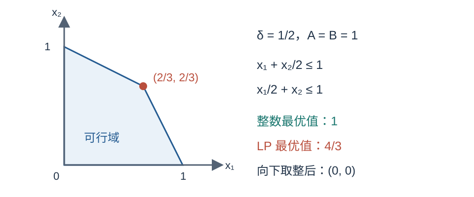{width=90%}

还要解释唯一性。任意最优 LP 解必须让相加后的上界取等号。两条原不等式的松弛量都非负，和为零时只能各自为零。因此两条资源约束都紧。它们相减得 $(1-\delta)(x_1-x_2)=0$；由于 $\delta\ne1$，可知 $x_1=x_2$。代回后唯一得到

```math
x_1^*=x_2^*=\frac1{1+\delta},\qquad
\mathrm{OPT}_{LP}=\frac2{1+\delta}.
```

两变量都严格小于 1，向下取整变成 $(0,0)$，价值为 0。它仍然可行，却相对正的最优价值没有任何固定因子的保证。可行性与质量是两项独立要求。

\newpage

### 1(c)：极点为什么至多有两个分数变量

极点（extreme point）是可行域中不能写成两个不同可行点中点的点。二维多边形的顶点是直观例子，但“极点”也适用于更高维。

若某点能沿一个非零方向向前、向后各走一点，两侧仍可行，那么它就在两个可行点之间，不是极点。原题提示正是要找到这样的方向。

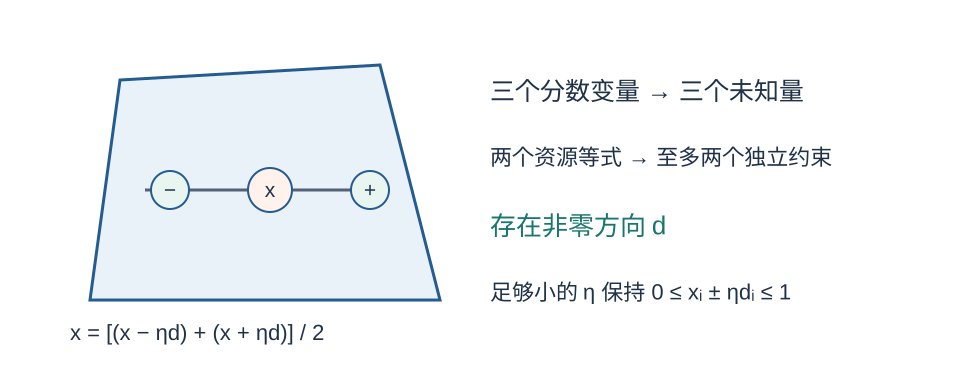{width=94%}

**完整证明。** 假设一个极点 $x$ 至少有三个分数坐标，选出三个下标 $i_1,i_2,i_3$。令其余 $d_i=0$，在这三个坐标上求解齐次方程

```math
\sum_i a_i d_i=0,\qquad \sum_i b_i d_i=0.
```

两个方程、三个未知量，系数矩阵的秩（独立方程的数量）至多为 2，故存在非零解 $d$。也可以这样理解：平面中的三个资源向量必然线性相关，能找到一组不全为零的系数，使它们相加为零。

对 $d_i\ne0$ 的坐标选择

```math
0\lt\eta\lt
\min_{i:d_i\ne0}\frac{\min\{x_i,1-x_i\}}{|d_i|}.
```

这些坐标都严格位于 $(0,1)$，所以右侧为正。这样 $x+\eta d$ 和 $x-\eta d$ 的全部坐标仍在 $[0,1]$；两种资源消耗又完全不变，故两点都可行。它们不同，且中点是 $x$，与极点定义矛盾。因此每个极点至多有两个分数变量。

这里没有假设两条资源约束都紧。扰动保持资源消耗不变，原来紧或不紧的约束都会继续满足。

\newpage

### 1(d)：保留整件物品，再与最佳单件比较

算法先求一个最优 LP 极点 $x^*$。令 $S=\{i:x_i^*=1\}$，将分数物品全部丢弃；再找价值最大的物品 $j$，返回 $S$ 与 $\{j\}$ 中价值更高的集合。

为什么需要单件备选？第 1(b) 已经表明 $S$ 可能为空。单件备选为这种情况下的损失提供补偿，而“每件单独可行”恰好保证这一步合法。

先证可行性。因为 $a_i,b_i\ge0$，丢掉分数物品不会增加任一资源消耗，故 $S$ 可行。题设保证 $\{j\}$ 可行。因此二者中较好的那个也可行。

令 $F=\{i:0\lt x_i^*\lt1\}$。由第 1(c)，$|F|\le2$。又因为 $j$ 的价值最大，每个 $v_i\le v_j$，且 $x_i^*\le1$，所以

```math
\begin{aligned}
\mathrm{OPT}
&\le\mathrm{OPT}_{LP}\\
&=v(S)+\sum_{i\in F}v_i x_i^*\\
&\le v(S)+2v_j\\
&\le3\max\{v(S),v_j\}.
\end{aligned}
```

最后一行来自 $v(S)\le m$、$v_j\le m$，其中 $m=\max\{v(S),v_j\}$。算法返回值就是 $m$，所以 $\mathrm{ALG}\ge\mathrm{OPT}/3$。

| 比较步骤 | 使用的事实 |
|:--|:--|
| $\mathrm{OPT}\le\mathrm{OPT}_{LP}$ | 最大化问题的 LP 松弛 |
| 分数部分至多损失 $2v_j$ | 至多两个分数变量，单件价值不超过 $v_j$ |
| $v(S)+2v_j\le3m$ | 两个候选值都不超过 $m$ |

题设允许在多项式时间求得最优极点。之后扫描 $n$ 个坐标构造 $S$，扫描价值寻找 $j$，求和并比较即可。因此它是多项式时间的 3-近似算法。不能只写“求任意最优 LP 解”：分数变量个数的结论是针对极点的。

\newpage

### 第 1 题复盘：一个完整的舍入证明长什么样

本题的证明顺序值得保留：先确认 LP 是上界，再寻找分数结构，最后设计一个能补偿舍入损失的整数候选。若跳过极点结构，直接丢掉全部分数物品，就无法控制损失。

**数值检查。** 在第 1(b) 取 $\delta=1/2$。LP 值为 $4/3$，两个变量都是 $2/3$。此时 $S=\varnothing$，最佳单件价值为 1，算法返回 1，恰好等于整数最优值。这个例子说明单件备选能修补空集合；它没有说明 3-近似界在此例达到。

**再检查比较链。** 假设某次求解后 $v(S)=10$、$v_j=7$。已证明的界给出 $\mathrm{OPT}\le10+2\times7=24$；算法返回 10。将 24 再放宽为 $3\times10=30$ 仍然成立。近似分析允许把较精确的实例界放宽为对所有输入统一有效的常数界。

| 常见写法 | 为什么不够 | 正确处理 |
|:--|:--|:--|
| “向下取整就得到近似解” | 没有估计价值损失 | 找到至多两个分数变量 |
| “最优解至多两个分数变量” | 对一般最优 LP 解未作保证 | 明确选择最优极点 |
| “最佳单件总是可行” | 一般背包不一定保证 | 引用本题的单件可行假设 |
| “整数与 LP 最优解相同” | LP 允许额外的分数选择 | 使用上界关系而非相等 |

你应能用一句话说明每个题设条件的作用：资源非负保证删物品仍可行；单件可行保证备选合法；最优极点保证分数个数受控；有理显式输入与题设 LP 事实保证多项式时间。

**自测 1。** 对 $m$ 种非负资源约束，若每件物品单独可行，同样的“极点舍入与最佳单件二选一”能推出什么因子？说明为什么。

**自测 2。** 若 LP 求解器返回第 1(b) 的分数点，价值 $4/3$，能否将它直接提交为原整数问题的答案？如果不能，算法实际输出什么？答案见附录。

\newpage
## 第 2 题：超图中的带权顶点覆盖

### 2(a)：覆盖的是超边，费用付给顶点

普通图的一条边连接两个顶点；超图的一条超边可以包含多个顶点。原题给出顶点集 $V$ 和非空超边集合 $\mathcal E$，每条超边最多有 $r\ge2$ 个顶点，每个顶点费用为正有理数 $c_v\gt0$，所有超边显式列出。

顶点覆盖 $C$ 要求每条超边至少包含一个被选顶点。费用是所有被选顶点费用之和，目标是最小化。一个顶点可以同时覆盖多条超边，但只付一次费用。

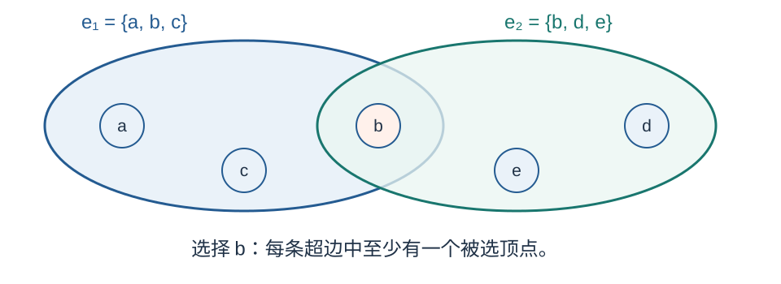{width=90%}

令 $x_v=1$ 表示选择顶点 $v$，得到整数规划

```math
\begin{aligned}
\min\quad &\sum_{v\in V}c_vx_v\\
\text{s.t.}\quad &\sum_{v\in e}x_v\ge1\qquad(e\in\mathcal E),\\
&x_v\in\{0,1\}\qquad(v\in V).
\end{aligned}
```

每条超边的约束都要求其成员选择量之和至少为 1。LP 松弛将二元限制改为 $0\le x_v\le1$。例如，三点超边允许各选 $1/3$，虽然原问题必须实际选中至少一个点。

因为这是最小化问题，整数可行域包含在 LP 可行域内，所以 $\mathrm{OPT}_{LP}\le\mathrm{OPT}$。后续会先把舍入费用控制在 LP 最优值的 $r$ 倍以内，再将它与整数最优费用比较。

若没有任何超边，空覆盖费用为 0，LP 也为 0，算法返回空集，保证仍成立。整数性间隙的比值只在分母为正时讨论；第 2(d) 的实例必有超边，因此不存在除零问题。

\newpage

### 2(b)–2(c)：阈值为何是 1/r

求一个最优 LP 解 $x^*$，选取 $C=\{v:x_v^*\ge1/r\}$。等于阈值的点也选入，这是可行性证明需要的边界规则。

**第 2(b)：证明覆盖。** 固定任意超边 $e$。反设它完全没有顶点入选，则对每个 $v\in e$ 都有 $x_v^*\lt1/r$。由于超边非空且 $|e|\le r$，

```math
\sum_{v\in e}x_v^*\lt\frac{|e|}{r}\le1.
```

这与 LP 约束 $\sum_{v\in e}x_v^*\ge1$ 矛盾。因此每条超边都至少被选中一个顶点，$C$ 是覆盖。

以 $r=3$ 为例，若三个成员都严格小于 $1/3$，总和一定小于 1。如果一条超边只有两个成员，它们全小于 $1/3$ 时总和甚至小于 $2/3$，同样不可能满足约束。算法只需要“最多 $r$ 个”，不需要每条超边恰好有 $r$ 个。

**第 2(c)：证明费用界。** 对每个入选顶点，$x_v^*\ge1/r$，故 $1\le r x_v^*$。乘以正费用并求和得

```math
\begin{aligned}
c(C)&=\sum_{v\in C}c_v\\
&\le r\sum_{v\in C}c_vx_v^*\\
&\le r\sum_{v\in V}c_vx_v^*\\
&=r\,\mathrm{OPT}_{LP}\le r\,\mathrm{OPT}.
\end{aligned}
```

第二个不等式只是把非负项补回去。这里不需要每个入选顶点的分数值恰好为 $1/r$，只需要它不小于阈值。

由于超边显式列出，LP 的变量数为 $|V|$，约束及系数总量与输入大小成多项式。求 LP、扫描变量、按阈值选点均可多项式完成，因此算法是多项式时间的 $r$-近似。

与第 1 题相比，本题不需要极点，也不需要限制分数变量个数。它利用的是“每条覆盖约束最多有 $r$ 个变量”。两题都从 LP 出发，但控制舍入损失的理由不同。

\newpage

### 2(d)：整数最优值与 LP 最优值分别怎样求

现在有 $n\ge r$ 个顶点，任意 $r$ 个顶点组成的集合都是超边，每个顶点费用为 1。超边总数为 $\binom nr$。符号 $\binom nr$ 表示从 $n$ 个不同对象中选 $r$ 个、不计顺序的方法数，例如 $\binom53=10$。

**整数最优值。** 若覆盖漏掉至少 $r$ 个顶点，从漏掉的点中任选 $r$ 个，就得到一条完全未覆盖的超边。因此最多漏掉 $r-1$ 个点，至少选 $n-r+1$ 个。反过来，任选 $n-r+1$ 个点，补集只有 $r-1$ 个，不可能容纳任何 $r$ 元超边，所以它确实是覆盖。

```math
\mathrm{OPT}=n-r+1.
```

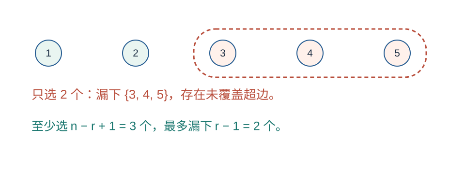{width=92%}

**LP 上界，即一个可行值。** 令每个 $x_v=1/r$，每条超边恰有 $r$ 个成员，其和为 1，故可行，目标值为 $n/r$。

**LP 下界，即不可能更低。** 将所有超边约束相加。共有 $\binom nr$ 条约束，而每个顶点恰好出现在 $\binom{n-1}{r-1}$ 条超边中，因为固定它之后，再从其他 $n-1$ 个点中选 $r-1$ 个。因此

```math
\binom{n-1}{r-1}\sum_{v\in V}x_v\ge\binom nr,
\qquad
\sum_{v\in V}x_v\ge
\frac{\binom nr}{\binom{n-1}{r-1}}=\frac nr.
```

可行值与下界相等，才证明 $\mathrm{OPT}_{LP}=n/r$。只展示均匀分数解可行，尚不能证明它最优。

\newpage

### 第 2 题复盘：LP 间隙不等于算法下界

由上一页两个最优值，得到该实例的比值

```math
\frac{\mathrm{OPT}}{\mathrm{OPT}_{LP}}
=\frac{n-r+1}{n/r}
=r\left(1-\frac{r-1}{n}\right).
```

固定 $r$，让 $n\to\infty$，最后一项趋于 $r$。这说明该 LP 的整数性间隙（integrality gap）至少可以逼近 $r$。第 2(c) 的分析同时给出任意非空实例 $\mathrm{OPT}\le r\mathrm{OPT}_{LP}$，所以这个 LP 的最坏间隙上确界为 $r$。

取 $r=3,n=5$，整数最优值为 3，LP 最优值为 $5/3$，比值为 $9/5=1.8$。固定 $r=3$、取 $n=30$，比值变成 $3\times28/30=2.8$。随着 $n$ 增大，它趋近 3，但有限 $n$ 时无需等于 3。

**这不能排除更好的多项式算法。** 整数性间隙比较的是整数最优值和某个特定 LP 的最优值。它说明无法对所有实例都证明某个整数解费用小于 $r$ 倍 LP 值的固定更好常数界。其他算法可能使用更强的松弛、额外结构或不同分析方法。

算法困难性下界则需要证明一整类算法不能达到某因子，往往涉及计算复杂性假设。本例没有完成这种证明，不能从“这个 LP 存在间隙”直接跳到“所有算法都有相同下界”。

还要区分“显式输入”和“用短句描述实例族”。这里数学上用“全部 $r$ 元子集”描述超边，但原问题要求显式列出。多项式时间是相对于展开后的输入长度；不能因为超边数可能很大，就断言 LP 算法不满足原题要求。

**自测 3。** 一条超边有三个顶点，LP 值均为 $1/3$。若把舍入条件误写为 $x_v\gt1/3$，会发生什么？

**自测 4。** 固定 $r=2,n=4$，超边是全部二元子集。求整数最优值、LP 最优值和二者之比，并解释该例不能证明任何算法都不可能优于 2-近似。

\newpage

## 第 3 题：带权支配集与价格分摊

### 3(a)：先理解闭邻域，再构造忽略费用的反例

原题给出最大度数为 $\Delta$ 的简单无向图，每个顶点费用为正有理数 $c_v\gt0$。闭邻域 $N[v]$ 包括 $v$ 自己及它的全部邻居。选择顶点 $v$，就能一次支配 $N[v]$ 中的点。

支配集 $D$ 要让每个顶点都被某个选中的顶点支配，目标是最小化所选顶点费用之和。它与顶点覆盖不同：顶点覆盖要求每条边有人选，支配集要求每个顶点受到照顾。

忽略费用的启发式每次选择能覆盖最多未支配顶点的点。构造三个点的路径 $a-b-c$，两端费用为 1，中心费用为 $L\gt2$。

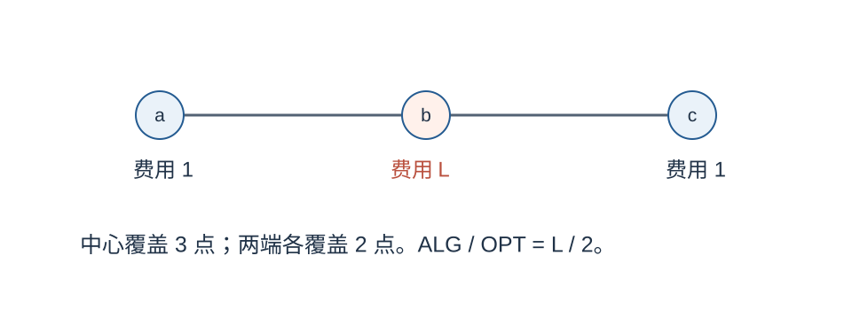{width=93%}

中心闭邻域为 $\{a,b,c\}$，两端闭邻域分别为 $\{a,b\}$、$\{b,c\}$。第一步中心覆盖 3 个点，两端各覆盖 2 个，所以启发式必选中心并结束，费用为 $L$，不存在需要依靠特定平局规则的问题。

最优解选择两端，费用为 2。为什么不能更低？单独选任一端都会漏掉另一端；若选中心，则费用至少为 $L\gt2$。因此 $\mathrm{OPT}=2$，比值为 $L/2$。令 $L$ 任意增大，比值也任意增大。

原题算法改用“每新增一个被支配点的平均费用”

```math
\frac{c_v}{|N[v]\cap U|},
```

其中 $U$ 是尚未被支配的点集，只考虑分母为正的候选。这样能把费用与当下新增收益放在同一个比较中。注意分母不是整个 $|N[v]|$：已经支配过的点不应重复算作新增收益。

\newpage

### 3(b)：把一次选择的费用平均分给新覆盖点

算法初始 $U=V,D=\varnothing$。每步选单位新增费用最小的顶点 $v$，令 $Q=N[v]\cap U$，将 $v$ 加入 $D$，再从 $U$ 中移除 $N[v]$。

给每个本步新被支配的点 $u\in Q$ 定价 $p_u=c_v/|Q|$。每个点只在第一次被支配时定价。这个价格是分析用的记账量，不是算法额外支付的一笔钱。

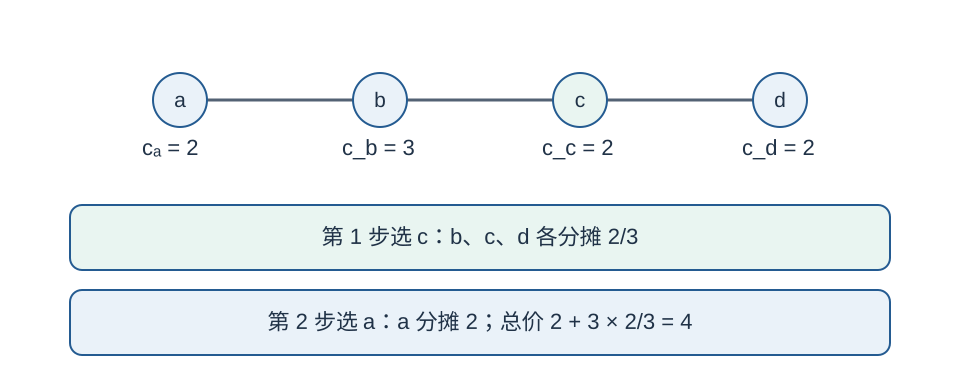{width=93%}

检查这次运行：初始各顶点的单位费用依次为 $2/2=1$、$3/3=1$、$2/3$、$2/2=1$，所以唯一先选 $c$。它新增支配 $b,c,d$，各点价格为 $2/3$。剩下 $a$ 未被支配，在仍能新增支配它的候选中，$a$ 费用为 2、$b$ 费用为 3，所以选 $a$，给它价格 2。最终总费用为 4，总价格也为 $2+3\times(2/3)=4$。

**完整证明。** 第 $t$ 步选择 $v_t$，新支配集合为 $Q_t$，则

```math
\sum_{u\in Q_t}p_u
=|Q_t|\cdot\frac{c_{v_t}}{|Q_t|}=c_{v_t}.
```

算法每步至少新支配一个点，直到所有点都被支配。因此各 $Q_t$ 两两不交，且并集为 $V$。把每步等式相加，得到

```math
\sum_{u\in V}p_u=\sum_t c_{v_t}=c(D).
```

最后一个等号还用到：已选顶点的闭邻域在该步后全部被支配，它以后分母为零，不会再次入选。因此每个费用只付一次。

\newpage

### 3(c)：固定一个候选顶点，比较每个点的价格

固定任意顶点 $v$，记其闭邻域大小为 $s=|N[v]|$，按被支配的时间把成员写成 $u_1,\ldots,u_s$。同一步覆盖多个成员时，可任意安排它们的先后。

考虑 $u_j$ 首次被支配的那一步，取该步开始前的未支配集合 $U_t$。记该步实际选择顶点为 $w$。因为算法选的是最小单位费用，若把 $v$ 也作为候选，就有

```math
p_{u_j}
=\frac{c_w}{|N[w]\cap U_t|}
\le\frac{c_v}{|N[v]\cap U_t|}.
```

为什么此时 $v$ 可作为分母为正的候选？因为 $u_j\in N[v]\cap U_t$，至少这个点还未被支配。

更进一步，列表中的 $u_j,u_{j+1},\ldots,u_s$ 在该步开始前都尚未被支配。因此 $|N[v]\cap U_t|\ge s-j+1$。分母越大，正数分式越小，于是

```math
p_{u_j}\le\frac{c_v}{s-j+1}.
```

同一步被覆盖的成员在任意打破平局后仍满足这点：列表中后面的成员至少不会早于该步被覆盖，所以在该步开始时也都还在 $U_t$ 中。这里需要的是“至少”，不是恰好剩下 $s-j+1$ 个。

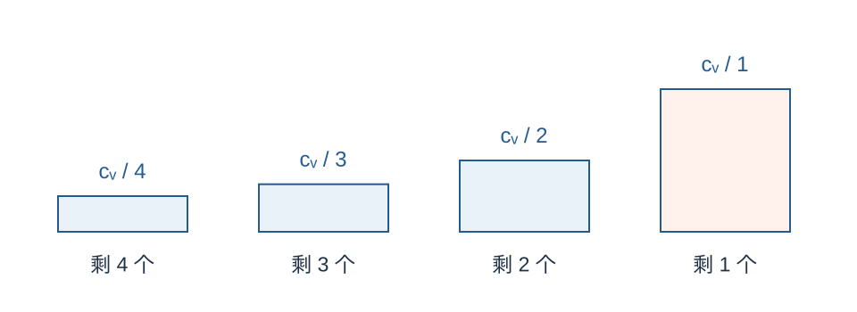{width=91%}

将所有成员的价格相加，反向的分母恰好遍历 $s,s-1,\ldots,1$：

```math
\sum_{u\in N[v]}p_u
\le c_v\sum_{j=1}^{s}\frac1{s-j+1}
=c_v\sum_{h=1}^{s}\frac1h
=H_s c_v.
```

$H_s$ 称为第 $s$ 个调和数（harmonic number）。例如 $H_1=1,H_2=3/2,H_3=11/6$。它来自逐渐减少的剩余覆盖数量。

\newpage

### 3(d)：用最优支配集把局部界接成全局界

令 $D^*$ 为一个最优支配集。它的闭邻域覆盖整个顶点集，因此每个 $u\in V$ 至少出现在一个 $v\in D^*$ 的 $N[v]$ 中。

所有价格非负，所以将最优解各闭邻域内的价格全部相加，可能重复计算某些点，但不会少算任何点。由第 3(b)、3(c)，

```math
\begin{aligned}
c(D)
&=\sum_{u\in V}p_u\\
&\le\sum_{v\in D^*}\sum_{u\in N[v]}p_u\\
&\le\sum_{v\in D^*}H_{|N[v]|}c_v\\
&\le H_{\Delta+1}\sum_{v\in D^*}c_v\\
&=H_{\Delta+1}\,\mathrm{OPT}.
\end{aligned}
```

为什么闭邻域大小至多为 $\Delta+1$？顶点最多有 $\Delta$ 个邻居，再加它自己。调和数随下标增大，所以 $H_{|N[v]|}\le H_{\Delta+1}$。

一个容易写错的地方是把第一条不等式写成等式。若某点同时位于两个最优解顶点的闭邻域中，它的价格在右侧被加了两次。重复计费在此处没有问题，因为我们需要的是一个上界。

**可行性与终止。** 当 $U$ 非空，任取其中一个点 $u$，因 $u\in N[u]$，顶点 $u$ 的分母至少为 1，所以总有候选。每步至少移走一个未支配点，最多 $|V|$ 步后 $U$ 为空，得到支配集。

**运行时间。** 使用邻接表存储图，标记各点是否仍在 $U$。一种直接实现每轮扫描所有闭邻域，累计 $|V|+2|E|$ 次成员检查，再选择最小比值。至多 $|V|$ 轮，因此是多项式时间。比较两个有理比值可以交叉相乘，不必依赖浮点近似；中间整数的位数也是输入长度的多项式。

算法不需要知道 $D^*$。它只在证明中被引入，作为把局部价格界汇总起来的参照对象。

\newpage

### 第 3 题复盘：从“贪心看起来合理”到可证明的界

贪心的局部选择通常不能直接推出全局保证。本题额外建立了一套价格：它们既精确记录实际费用，又能在任意固定闭邻域中受控。这两个性质结合起来，才能与最优解比较。

可以用下面的证明骨架检查自己是否漏步：

1. 每步将费用平均分给新被支配的点，故总价格等于算法费用。
2. 固定任一候选闭邻域，用贪心最小比值比较每个点的价格。
3. 按覆盖顺序求和，得到闭邻域价格和至多为其费用的 $H_s$ 倍。
4. 用最优支配集的闭邻域覆盖全图，允许重复相加，获得全局上界。

第 3 步中，只固定某个顶点 $v$，不要求算法最终选过它；第 4 步才把这个对“任意 $v$”成立的结论用于最优解成员。这种先证明通用局部性质、再选择比较对象的顺序很常见。

| 概念或边界 | 本题应怎样处理 |
|:--|:--|
| 开邻域与闭邻域 | 闭邻域包含自身，否则 $\Delta+1$ 会被写错 |
| 已经覆盖过的点 | 不算新增收益，不再分配价格 |
| 同时覆盖多个点 | 任意打破平局，使用剩余数量“至少”为某值 |
| 分母为零 | 不作为候选，避免无意义的比值 |
| 孤立点 | 闭邻域只有自身，必须选它，分析仍适用 |
| 所有点均孤立 | $\Delta=0,H_{\Delta+1}=H_1=1$，算法最优 |

以四点路径的例子，最终价格是 $(2,2/3,2/3,2/3)$。对于顶点 $b$，闭邻域价格和为 $10/3$，确实不超过 $H_3c_b=(11/6)\times3=11/2$。局部界可以留有余量，不要求每个候选闭邻域都取到等号。

**自测 5。** 在三点路径 $a-b-c$ 中，费用分别为 $1,100,1$。按原题带费用的贪心，第一步会选哪一类点？最终费用是多少？

**自测 6。** 若某个闭邻域包含四个点，为什么价格和上界是 $H_4c_v=(25/12)c_v$，而不是 $4c_v/4=c_v$？

\newpage
## 第 4 题：通过终端 MST 构造 Steiner 树

### 4(a)：原图与终端距离图是两个不同的图

给定连通无向图 $G=(V,E)$，边费用是正有理数。终端集合 $R$ 有 $k\ge2$ 个点。Steiner 树必须连接所有终端，可以额外使用非终端，但不要求包含原图的全部顶点。

最小生成树（minimum spanning tree，MST）则要在指定图上连接该图的全部顶点。本题不是直接求原图的 MST，而是先只以终端为顶点建立另一个图。

定义 $d(u,v)$ 为原图中 $u,v$ 间的最短路距离。终端完全图在任意两终端之间都有一条“虚拟边”，边权为 $d(u,v)$。这条虚拟边可以对应原图中经过多个非终端的路径。

{width=42%}

**三角不等式。** 将 $u$ 到 $w$ 的最短路径和 $w$ 到 $v$ 的最短路径拼接，得到一条 $u$ 到 $v$ 的行走路线，费用为 $d(u,w)+d(w,v)$。最短路费用不超过任何这类路线，故

```math
d(u,v)\le d(u,w)+d(w,v).
```

即使拼接产生重复顶点，也能删去回路而不增加费用。无向性给出对称性，正费用保证不同点间距离为正，且 $d(u,u)=0$。

**多项式实现。** 从各终端运行最短路算法并保留路径前驱，构造至多 $k(k-1)/2$ 条距离边；用 Prim 或 Kruskal 求 MST；展开其 $k-1$ 条边；最后用 DFS 或 BFS 提取生成树。标准实现的步骤与有理数位运算均为输入长度的多项式。

\newpage

### 4(b)：路径并集为什么连通，费用为什么不会增加

记终端距离图中的 MST 为 $M$。把每条虚拟边 $uv\in M$ 替换为原图中一条长度为 $d(u,v)$ 的最短路径，所得路径并集记为 $H$。

**连接性。** 对任意两个终端，$M$ 中都有一条连接它们的树路径。将该树路径上的虚拟边逐一展开后，就得到 $H$ 中连接这两个终端的路线。因此所有终端在 $H$ 中连通。每个出现在并集里的非终端又位于某条展开路径上，也与终端连通，所以整个 $H$ 连通。

**费用比较。** 逐条路径求和时，一条原图边若被多条路径使用，就会被重复收费；路径并集中的每条边只计一次。因此

```math
c(H)\le\sum_{uv\in M}d(u,v)=d(M).
```

路径展开也可能产生环。若有环，删掉环上的任一边，不破坏连通性；由于费用为正，费用下降。重复去环得到 $H$ 的一棵生成树 $A$，它仍包含全部终端，因而是可行 Steiner 树，并且

```math
c(A)\le c(H)\le d(M).
```

**共享边的小例子。** 原图是中心 $s$ 连接三个终端 $a,b,c$ 的星形，每条边费用为 1。终端间距离都是 2。若终端 MST 选 $ab,bc$，其距离费用为 4；展开得到路径 $a-s-b$ 与 $b-s-c$。分别求和时 $sb$ 收了两次，路径并集只有三条边，费用为 3。因此这里 $c(A)=3\lt4=d(M)$。

这个例子也说明不要把 $c(A)$ 与 $d(M)$ 直接写成相等。算法输出费用可能因路径共享或删环而更低。

| 对象 | 所在位置 | 包含什么 |
|:--|:--|:--|
| $M$ | 终端距离图 | 终端与虚拟距离边 |
| $H$ | 原图 | 展开的最短路径并集，可能有环 |
| $A$ | 原图 | $H$ 的生成树，连接全部终端 |
| $T^*$ | 原图 | 分析时使用的最优 Steiner 树 |

\newpage

### 4(c)：倍增树边、Euler 回路与终端捷径

设 $T^*$ 是最优 Steiner 树。我们不知道它，但可以在证明中用它构造一个费用受控的终端环。这里暂取 $k\ge3$。

把 $T^*$ 的每条边复制一份，得到连通多重图。每个顶点度数都变成偶数，因此存在 Euler 回路，即每条边副本恰走一次的闭合行走。总费用为 $2c(T^*)$。也可以想象从根出发遍历树，每条原边去一次、回一次。

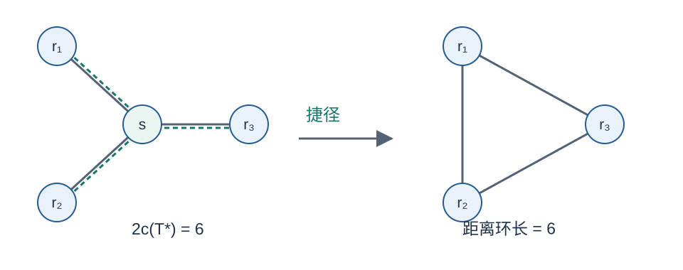{width=94%}

从一个终端出发，按 Euler 行走中第一次遇见各终端的顺序记为 $r_1,\ldots,r_k$。从 $r_i$ 的这次出现走到 $r_{i+1}$ 的第一次出现，是原行走的一段；最后从 $r_k$ 走到起始终端 $r_1$，包含余下的所有行走。

这 $k$ 段将整个回路分完。每段可能经过非终端，甚至重复经过已经记录的终端，但这些都不影响距离比较：$d(r_i,r_{i+1})$ 不超过该段路线的费用。逐段相加得

```math
\sum_{i=1}^{k}d(r_i,r_{i+1})\le2c(T^*),
\qquad r_{k+1}=r_1.
```

把中间绕行替换成最短路距离，通常称为“取捷径”（shortcutting）。三角不等式保证跨过中间点不会更贵。终端环位于距离图中，不要求原图本来就有直接连接这些终端的边。

注意两个不同概念：Euler 回路允许重复顶点，但每个边副本只走一次；最终终端循环排列中，每个终端只列一次。它们之间通过第一次访问顺序和距离捷径联系起来。

\newpage

### 4(d)：删掉最贵的一条边，改善 2 倍界

设第 4(c) 构造的终端环总费用为 $L$，共有 $k$ 条边。至少一条边的费用不小于平均值 $L/k$，否则所有边都小于平均值，总和反而会小于 $L$。

删去一条最贵边，剩下一个连接所有终端的路径 $P$，它本身也是终端距离图上的生成树，费用满足

```math
d(P)\le L-\frac Lk=\left(1-\frac1k\right)L.
```

因为 $M$ 是终端距离图上的最小生成树，它不比任何其他终端生成树更贵，特别是 $d(M)\le d(P)$。结合之前的两条界，得到

```math
\begin{aligned}
c(A)&\le d(M)\\
&\le d(P)\\
&\le\left(1-\frac1k\right)L\\
&\le2\left(1-\frac1k\right)c(T^*).
\end{aligned}
```

算法不需要真的找到 $T^*$、Euler 回路或这条终端环。它只求终端 MST。后面的对象是为了证明：存在一个不太贵的终端生成树，所以 MST 一定不会更贵。

**两个终端必须单独处理。** 当 $k=2$，设终端为 $u,v$。终端距离图只有一条边，展开后就是原图中一条最短 $u$–$v$ 路径，费用 $d(u,v)$。任意可行 Steiner 树都含有一条 $u$–$v$ 路径，其费用至少为 $d(u,v)$，且整树费用不低于这条路径。故

```math
\mathrm{OPT}=d(u,v)=c(A).
```

这也与 $2(1-1/2)=1$ 一致，但直接把 $k=2$ 代入因子不等于已经完成证明：前面使用的简单终端环论证专门针对 $k\ge3$。

对小规模终端，改进因子很明显。例如 $k=3$ 时为 $4/3$，$k=4$ 时为 $3/2$；终端数越来越多时才逐渐趋近 2。

\newpage

### 4(e)：证明紧例时，不能漏掉混合使用两类边的树

实例有 $k\ge3$ 个终端和一个额外顶点 $s$。中心到每个终端的边费用为 1；任意两终端之间的边费用为 $2-\varepsilon$，其中 $0\lt\varepsilon\lt(k-2)/(k-1)\lt1$。

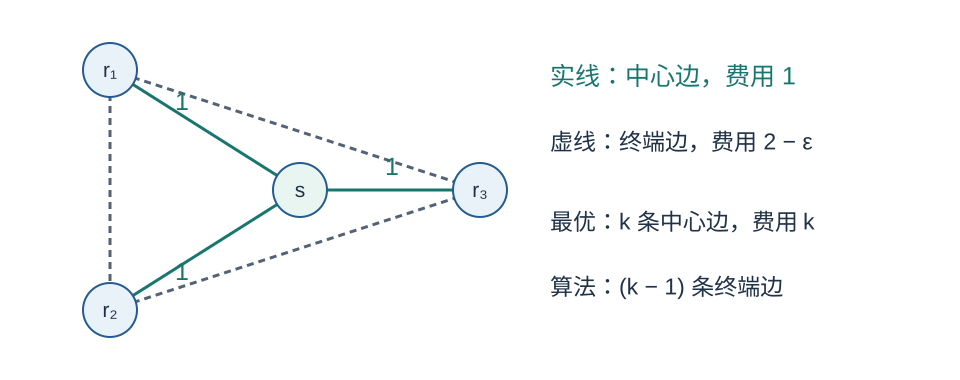{width=94%}

**求 OPT。** 全选中心边得到一棵费用为 $k$ 的星形树。任意可行树分两类：若不含 $s$，它只有 $k$ 个顶点、$k-1$ 条终端边，费用为 $(k-1)(2-\varepsilon)\gt k$，其中严格不等式正来自题设的 $\varepsilon$ 上界。

若包含 $s$，它有 $k+1$ 个顶点、$k$ 条边。设中心边有 $t$ 条，则其余 $k-t$ 条是终端边，总费用为

```math
t+(k-t)(2-\varepsilon)
=k+(k-t)(1-\varepsilon)\ge k.
```

因此混合树也不会优于星形，得到 $\mathrm{OPT}=k$。

**求算法费用。** 两终端之间的直接边费用 $2-\varepsilon\lt2$，比经中心的两条边更便宜。经其他终端的路线至少含更多正费用边，也不会更短；任何经过中心的路线费用至少为 2。因此终端最短距离均为 $2-\varepsilon$，最短路径就是直接边。

终端 MST 有 $k-1$ 条这样的边，展开不改变边集，也不会产生需要删掉的环，所以

```math
c(A)=(k-1)(2-\varepsilon),\qquad
\frac{c(A)}{\mathrm{OPT}}
=\frac{(k-1)(2-\varepsilon)}k
\longrightarrow2\left(1-\frac1k\right)
\quad(\varepsilon\downarrow0).
```

\newpage

### 第 4 题复盘：算法构造与分析构造分开记

本题有两条不同的路线。算法路线是“原图距离 → 终端 MST → 最短路展开 → 去环”。分析路线是“最优树 → 倍增 → 终端环 → 删最大边 → 一个便宜的终端生成树”。两条路线在“终端 MST 不比任何终端生成树贵”处接上。

如果只记最终因子，容易忘掉 $1-1/k$ 从何而来。它来自终端环恰有 $k$ 条边，最贵边至少占总费用的 $1/k$；删它后保留的费用至多是 $1-1/k$。

**数值检查。** 取 $k=3,\varepsilon=1/4$，符合 $0\lt\varepsilon\lt1/2$。最优星形费用为 3。算法选择两条终端边，费用为 $2\times(7/4)=7/2$，比值为 $7/6$，低于理论上界 $4/3$。令 $\varepsilon$ 继续减小，比值才逐渐接近 $4/3$。

当含中心的混合树只有两条中心边、一条终端边时，费用为 $2+7/4=15/4$，高于 3；当完全不含中心时费用为 $7/2$，也高于 3。只比较“纯星形”与“纯终端树”虽然在这个例子中能猜对答案，却不构成排除所有混合方案的证明。

| 常见混淆 | 需要记住的区别 |
|:--|:--|
| 原图 MST 与终端 MST | 前者连接原图所有点，本题只在终端距离图上求 MST |
| 最短路径费用之和与并集费用 | 共享原图边只在并集中计一次 |
| Steiner 树与原图生成树 | Steiner 树可以不包含某些非终端 |
| 倍增遍历与终端循环 | 前者可重复点，后者只列每个终端一次 |
| 图上恰好达到与极限逼近 | 紧性可由一族输入的比值趋近来证明 |

**自测 7。** 若一棵最优 Steiner 树费用为 12，有四个终端，本题保证算法费用至多多少？说明删边步骤贡献了哪个因子。

**自测 8。** 紧例取 $k=4,\varepsilon=1/3$。求 OPT、算法费用及比值；再检查一棵含 $s$、只有两条中心边的混合树费用。

\newpage
## 第 5 题：租赁价格变化时的租或买

### 5(a)：离线最优为什么只比较“一直租”和“第一天买”

你连续需要机器 $T\ge1$ 天，但在线算法不知道哪一天会结束。购买价格固定为正有理数 $B\gt0$；第 $t$ 天开始时才公布当天的正有理数租金 $r_t\gt0$。算法在使用机器之前决定租或买，所以当天买就不需要支付当天租金，买后各天免费。

离线最优预先知道完整的天数和租金。若它从不购买，总费用是 $\sum_{t=1}^{T}r_t$。若它某天购买，总费用为“此前付过的租金加 $B$”，至少为 $B$；直接在第一天买能使这个费用降为 $B$，并且仍满足所有天的需求。

所以任何延后购买方案都不比第一天购买便宜，离线最优只需比较这两类方案：

```math
\mathrm{OPT}=\min\left\{B,\sum_{t=1}^{T}r_t\right\}.
```

这个结论依赖“购买价格每天相同”和“购买后永久免费”。它不是对任意租赁模型都成立的通用公式。如果购买价格也变化，延后购买就可能有意义，但那不是本题。

**离线知道未来，不代表可以改变价格。** 它只是提前知道输入，所以能在第一天选对两种方案。在线算法看见前两天租金很低时，仍不知道第三天是否有需求、租金是否会骤升。

原题算法维护已经实际支付的租金 $R$，购买前每天按下式决策：

```math
\begin{cases}
\text{支付 }B\text{ 购买},&R+r_t\ge B,\\
\text{支付 }r_t\text{ 租用，更新 }R\leftarrow R+r_t,
&R+r_t\lt B.
\end{cases}
```

注意 $R$ 不包含尚未支付的当天租金。判断时使用 $R+r_t$，不代表先支付 $r_t$ 再买。阈值比较是行动前的预算检查，正是它避免了被某天的巨大租金击穿保证。

\newpage

### 5(b)：逐日计算与错误规则的反例

取 $B=10$，租金依次为 $(3,4,5,1)$。按每天开始前的 $R$ 判断：

| 天数 | 当天租金 | 判断前的 R | 决策与实际付款 |
|:--|:--|:--|:--|
| 1 | 3 | 0 | $0+3\lt10$，租用并支付 3 |
| 2 | 4 | 3 | $3+4\lt10$，租用并支付 4 |
| 3 | 5 | 7 | $7+5\ge10$，购买并支付 10 |
| 4 | 1 | 已购买 | 免费使用，不再比较租金 |

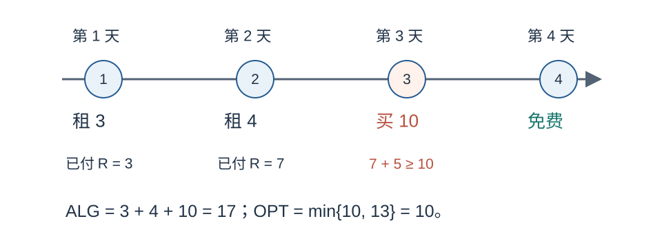{width=94%}

因此 $\mathrm{ALG}=3+4+10=17$。全程租金和为 $3+4+5+1=13$，所以 $\mathrm{OPT}=\min\{10,13\}=10$，本次比值为 $17/10=1.7$。

另一条规则是：先照常租，直到已经付出的租金累计至少为 $B$，下一次有需求才买。这条规则在常租金问题中看起来接近阈值策略，但在租金可能突然很高时没有有限竞争比。

**反例。** 固定 $B=1$，只需要一天，即 $T=1$。令第一天租金为任意大的正有理数 $K\gt1$。错误规则尚未累计到阈值，会先租这一天，费用为 $K$；离线第一天买，费用为 1。比值为 $K$，可以任意大。

一天就已经足够，不必强行再加第二天购买。正确规则在第一天看到 $r_1=K\ge B$ 时直接购买，因此费用为 1。差别完全发生在付款之前的判断时机。

\newpage

### 5(c)：用不变量证明 2-竞争

初始 $R=0\lt B$。如果某天租用，算法已经检查过 $R+r_t\lt B$，更新后的已付租金仍严格小于 $B$；如果某天购买，租金累计不再更新。因此购买前始终保持 $R\lt B$。

{width=80%}

将输入分成两种情况。

**从未购买。** 最后一天之后仍有 $R=\sum_t r_t\lt B$，所以离线最优也选择一直租。算法费用恰好等于 $\mathrm{OPT}=R$。

**在第 $\tau$ 天购买。** 设购买前已付租金为 $R$。购买触发条件为 $R+r_\tau\ge B$，所以完整输入的全部租金之和至少为 $B$；由第 5(a)，$\mathrm{OPT}=B$。算法实际费用则是

```math
\mathrm{ALG}=R+B\lt2B=2\,\mathrm{OPT}.
```

这里不能把 $r_\tau$ 再加到算法费用中，因为买的当天不租。该租金只用于证明“如果一直租，总租金已经达到 $B$”。

两种情况覆盖所有有限输入，所以算法满足 $\mathrm{ALG}\le2\mathrm{OPT}$，是 2-竞争算法，没有额外加性常数。每个购买前的活动日只需一次比较与一次更新，购买后免费，整个过程相对于显式输入长度为多项式。

严格小于 $2\mathrm{OPT}$ 是逐输入的性质。下一问将说明它无法统一改成某个固定小于 2 的乘数。

\newpage

### 5(d)：固定租金实例族与精确竞争比

固定整数 $M\ge2$，每天租金都是 $B/M$。在前 $M-1$ 天，算法一直租；若需求持续到第 $M$ 天，则在当天购买。

原因是第 $t$ 天之前，若还没买，已经付了 $(t-1)B/M$。当天租金加上去为 $tB/M$，首次达到 $B$ 恰好发生在 $t=M$。

| 需求期限 | 算法费用 | 离线最优 | 比值 |
|:--|:--|:--|:--|
| $1\le T\lt M$ | $TB/M$ | $TB/M$ | 1 |
| $T\ge M$ | $(M-1)B/M+B$ | $B$ | $2-1/M$ |

因此，在“固定这个 $M$，只改变有限期限 $T$”的实例族中，最坏比值恰好为 $2-1/M$，而且任意 $T\ge M$ 都能达到它。

例如 $M=5,B=10$，每天租金为 2。前四天共付 8，第五天买并付 10，总费用为 18。期限若至少五天，离线费用为 10，比值为 1.8；期限若只有三天，双方费用都是 6。

现在允许 $M$ 越来越大，就有

```math
2-\frac1M\longrightarrow2.
```

假设想给这个阈值算法宣称一个固定保证 $c\lt2$。选择足够大的整数 $M$，使 $1/M\lt2-c$，则上述有限输入的比值 $2-1/M\gt c$，直接违背该保证。

第 5(c) 已证明统一上界 2，这里又证明任何小于 2 的常数都不够，所以阈值算法在完整变动租金问题上的精确竞争比是 2。

到这里，还只是证明“这个算法不能更好”。要证明所有确定性在线算法都不能优于 2，需要下一问的对抗分析。一个算法的坏例子不自动构成所有算法的下界。

\newpage

### 5(e)：任意确定性算法都无法优于 2

固定任意确定性在线算法和整数 $M\ge2$。给它持续提供每天租金为 $B/M$ 的输入。因为算法不知道未来期限，处理任何共同前缀时的决策相同，所以可以观察它何时首次购买，再决定在哪一天结束需求。

这不是允许算法在看到结束后改决定：第 $\tau$ 天开始时，它只知道当天有需求，不知道当天是否为最后一天。

**情形一：首次购买日 $\tau\le M$。** 在第 $\tau$ 天结束。之前租了 $\tau-1$ 天，算法费用为 $(\tau-1)B/M+B$；全程租金为 $\tau B/M\le B$，故

```math
\frac{\mathrm{ALG}}{\mathrm{OPT}}
=\frac{B+(\tau-1)B/M}{\tau B/M}
=1+\frac{M-1}{\tau}
\ge2-\frac1M.
```

**情形二：首次购买日 $\tau\gt M$。** 仍在第 $\tau$ 天结束，离线费用为 $B$。因 $\tau$ 为整数，$\tau\ge M+1$，所以

```math
\frac{\mathrm{ALG}}{\mathrm{OPT}}
=1+\frac{\tau-1}{M}\ge2\ge2-\frac1M.
```

**情形三：算法永不购买。** 取有限期限 $T=2M$，算法租金为 $2B$，离线费用为 $B$，比值为 2。也可取更长期限使比值继续增加。

所以任意确定性在线算法在这个固定租金实例族上，最坏比值至少为 $2-1/M$。阈值算法能达到这个界，因此固定 $M$ 时该下界也是可达到的。

最后令 $M$ 任意增大。若某算法声称完整问题的竞争比是 $c\lt2$，选 $M$ 使 $2-1/M\gt c$，就得到矛盾。于是不存在竞争比小于 2 的确定性在线算法。结合阈值算法上界 2，可知它在这一确定性模型下最优。

\newpage

### 第 5 题复盘：信息时机决定证明是否成立

本题不难计算，但很容易在信息顺序上出错。每天的顺序是：知道今天要用，看到今天租金，选择租或买，然后使用机器。算法不知道明天是否还有需求，却知道当日租金。

| 数量 | 包含哪些钱 | 用在何处 |
|:--|:--|:--|
| $R$ | 购买前已经实际支付的租金 | 不变量 $R\lt B$ |
| $R+r_t$ | 已付租金加当天公布租金 | 决定今天是否买 |
| $R+B$ | 已付租金加购买费 | 购买后的算法总费用 |
| $\sum_t r_t$ | 若一直租完整输入的费用 | 离线最优比较 |

这四个量不能随意互换。特别是触发购买当天的 $r_t$，出现在阈值判断和离线租金总和中，却不出现在算法实际付款中。

“没有加性常数”表示性能界就是乘法界。例如 $\mathrm{ALG}\le2\mathrm{OPT}+100$ 不满足本题对 2-竞争的定义。这里证明直接控制 $R+B\lt2B$，不需要补上额外常数。

对抗输入的三种分支同样不能少：过早买，需求可能立刻结束；过晚买，前面的租金已经很多；永不买，长期限会使租金不断增长。证明不是说算法“应该知道未来”，而是证明在相同已知信息下，不可能同时防住所有未来。

**自测 9。** 若 $B=12$，租金为 $(2,3,7,100)$，正确阈值算法何时买？总费用与 OPT 分别是多少？注意等于阈值时的处理。

**自测 10。** 固定每天租金为 $B/4$。一个确定性算法首次在第 2 天买，对抗者当天结束。另一个首次在第 6 天买，对抗者也当天结束。分别算费用比，并与 $2-1/4$ 比较。

本题的随机化算法并不在原题范围内。上述确定性下界不自动覆盖随机算法，因为对手怎样观察随机选择、怎样决定输入，需要另行定义。

\newpage
## 第 6 题：带容量的在线匹配

### 6(a)：同一请求放到哪里，会影响后续能否接纳

离线顶点集 $V$ 事先已知，每个顶点容量为整数 $b_v\ge1$，二进制给出。在线请求 $u$ 按对手安排的顺序逐个到达，到达时才知道邻居集合 $N(u)$。必须立即分配给一个有空余容量的邻居，或永久拒绝；不能撤销，也不能让一个请求占用多个位置。

原题贪心只要求“只要有空位邻居就接纳”，有多个空位邻居时可任意选择。本题上界证明不依赖某种特定平局规则。

第 6(a) 给出 $V=\{a,b\}$，容量 $b_a=2,b_b=1$。依次到达的请求邻居为 $N(u_1)=\{a,b\}$、$N(u_2)=\{a\}$、$N(u_3)=\{a\}$。本小问指定贪心优先选择 $a$。

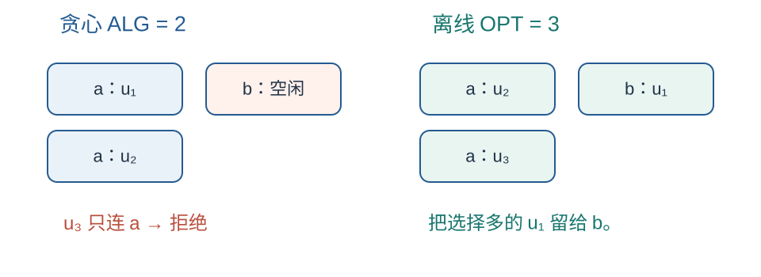{width=94%}

贪心先令 $u_1\to a$，$a$ 剩一个空位；再令 $u_2\to a$，$a$ 已满；最后拒绝 $u_3$。所以 $\mathrm{ALG}=2$。

离线令 $u_1\to b$、$u_2\to a$、$u_3\to a$，三个请求全部接纳，得到 $\mathrm{OPT}=3$。由于一共只有三个请求，不可能超过 3，因此已经证明最优。

本次比值为 $2/3$，并非理论最坏界 $1/2$。它展示的现象是：一个选择很多的请求，可能占用了另一个请求唯一可用的位置。在线算法当时看不到未来，很难始终避开这种占用。

若邻居集合为空，贪心直接拒绝，离线也不能接纳该请求。这样的输入不需要额外设计例外规则，后续计数证明同样适用。

\newpage

### 6(b)：一个计数器就能表示大容量

为每个离线顶点存储已使用容量 $q_v$，初始为 0。请求到达时扫描它的邻居，遇到 $q_v\lt b_v$ 就分配并增加计数；若没有这种邻居则拒绝。

```text
对每个离线顶点 v：q[v] ← 0
对每个到达请求 u：
    在 N(u) 中寻找满足 q[v] < b[v] 的顶点 v
    若找到：
        将 u 分配给 v
        q[v] ← q[v] + 1
    否则：
        永久拒绝 u
```

这里是语言无关的伪代码，不是需要实际运行的 Python。即使 $b_v=2^{100}$，算法也只存一个大约 101 位的整数容量和一个计数器，不创建 $2^{100}$ 个槽位对象。

令在线请求数为 $m$，显式邻接表总长度为 $L=\sum_u|N(u)|$，最大容量位数为 $\ell$。扫描总共检查至多 $L$ 个邻居，每次比较或计数更新处理 $O(\ell)$ 位即可。再加请求本身的遍历，时间可以界为 $O((|V|+m+L)\ell)$ 的量级，因而关于输入长度为多项式。

这个表达式按朴素二进制位运算估计，省略了顶点标识查找等常规存储开销；无论采用数组或适当字典，它们都可以在输入长度的多项式内实现。实际已用计数还不超过请求总数 $m$。

**为什么不复制顶点？** 数值 $b_v$ 的大小可能是其表示长度的指数。算法若循环 $b_v$ 次，即使每次操作很简单，仍可能对输入位数呈指数增长。分析证明中可以把容量想成多个槽位来帮助理解，但实现不需要，也不应真的展开。

| 保存在机器中的状态 | 是否需要 |
|:--|:--|
| 每个离线顶点的容量 $b_v$ 与计数 $q_v$ | 需要 |
| 当前请求的邻接表 | 需要 |
| 为容量中的每一个单位创建一个顶点副本 | 不需要 |
| 未来所有请求的邻居 | 在线决策时不可获得 |

\newpage

### 6(c)：把贪心错过的最优请求归到饱和顶点

固定完整输入和一个最优离线分配。令 $A$ 是贪心接纳的请求集合，$O$ 是离线最优接纳的请求集合，$S$ 是贪心在输入结束时已经用满容量的离线顶点集合。

考虑任意 $u\in O\setminus A$。它被最优解接纳，却被贪心拒绝。根据贪心规则，拒绝时它的每个邻居都没有剩余容量，否则算法必须选某个空位邻居接纳它。

容量只会被占用，不会释放。因此那些当时已满的邻居到输入结束时仍满，全部属于 $S$。最优解分给 $u$ 的顶点必定是它的一个邻居，所以也属于 $S$。于是 $O\setminus A$ 中的每个请求都在最优解中被放到 $S$。

**第一次计数：按最优解的容量数。** 最优解也必须遵守每个离线顶点的容量限制。放到 $S$ 的这些请求总数至多为

```math
|O\setminus A|\le\sum_{v\in S}b_v.
```

不必要求最优解只把 $O\setminus A$ 的请求放到 $S$；若还放了其他请求，只会进一步占用容量，使这条上界继续成立。

**第二次计数：按贪心已经做出的分配数。** 对每个 $v\in S$，贪心恰好在它上面做了 $b_v$ 次分配。不同离线顶点上的贪心请求不重叠，因为一个请求最多分配一次。因此

```math
\sum_{v\in S}b_v\le|A|.
```

合起来得到原题所需的链：

```math
|O\setminus A|\le\sum_{v\in S}b_v\le|A|.
```

这是一种容量记账：将最优解中贪心错过的请求数量，限制在贪心已经填满的位置数量以内。它不声称两个算法把共同接纳的请求放在同一顶点上，也不要求逐个构造同名匹配边。

\newpage

### 6(d)：从集合分解得到 1/2-竞争

将最优接纳集合拆成两部分：也被贪心接纳的 $O\cap A$，以及被贪心错过的 $O\setminus A$。两者不交，因此

```math
\begin{aligned}
\mathrm{OPT}=|O|
&=|O\cap A|+|O\setminus A|\\
&\le|A|+|A|\\
&=2\,\mathrm{ALG}.
\end{aligned}
```

第一部分显然至多为 $|A|$；第二部分由第 6(c) 也是至多为 $|A|$。所以

```math
\mathrm{ALG}\ge\frac12\,\mathrm{OPT}.
```

这对任意有限输入成立，没有加性项，因此贪心是 $1/2$-竞争算法。若输入根本没有可接纳请求，双方值都为 0，不等式仍成立；不需要去计算未定义的 $0/0$ 比值。

用第 6(a) 再核对一次：$A=\{u_1,u_2\}$，$O=\{u_1,u_2,u_3\}$，饱和集合 $S=\{a\}$。于是

```math
|O\setminus A|=1\le b_a=2\le|A|=2,
\qquad |O|=3\le2|A|=4.
```

界留有余量完全正常。一个通用证明必须兼容最坏输入，但不要求每个输入都让所有不等式取等号。

如果尝试直接说“每个贪心匹配最多挡住一个最优匹配”，很容易忽略容量和共同请求的分配变化。本题使用饱和集合的两次计数，避免了给每条匹配边强行一一对应。

| 证明对象 | 为什么出现 |
|:--|:--|
| $O\cap A$ | 已经共同接纳，不需要补偿 |
| $O\setminus A$ | 需要控制的遗漏量 |
| $S$ | 所有遗漏请求在最优解中的目标都落在这里 |
| $\sum_{v\in S}b_v$ | 连接遗漏量与贪心已完成分配数 |

\newpage

### 6(e)：两个单位容量顶点足以证明下界

要证明任意确定性在线算法都不能保证严格大于 $1/2$ 的比例，只需要考虑模型中的一个特殊情况：两个离线顶点 $a,b$ 的容量都为 1。

第一个请求 $u_1$ 的邻居为 $\{a,b\}$。观察确定性算法如何处理这个请求，再选择后续输入。

{width=64%}

**若拒绝 $u_1$，立即结束。** 算法值为 0，离线可接纳它，最优值为 1。这已经违反任何正的统一竞争比例。

**若分配给某个 $v\in\{a,b\}$，再到达 $u_2$，仅连接 $v$。** $v$ 已满，算法无法接纳 $u_2$，所以值为 1。离线知道后续请求，会把 $u_1$ 放到另一个顶点、$u_2$ 放到 $v$，值为 2。算法比例只有 $1/2$。

于是任意确定性算法都存在一个有限输入，使其比例至多为 $1/2$。结合第 6(d)，贪心达到了确定性在线模型下的最佳统一保证。

对于固定的确定性算法，第一步决策可由同一前缀确定，因此上述分支最终形成一个具体输入。这里不涉及撤销输入或让算法重新选择。它同样不自动证明随机算法的下界。

**自测 11。** 容量 $b_a=b_b=1$，先到达邻居为 $\{a,b\}$ 的 $u_1$，贪心将它放到 $b$。为使贪心最终只得 1、离线得 2，第二个请求应连接谁？

**自测 12。** 某个顶点容量为 $2^{60}$，输入实际只有 100 个请求。为什么计数器实现仍可行，而创建所有容量副本不满足关于容量表示长度的多项式时间要求？

\newpage

## 复习附录：速查、自测答案与来源

### 六题结论与证明方法速查

下表用于回忆证明主线，不替代正文推导。复习时先看题名，尝试自行写出比较链，再用表格检查。

| 题目 | 算法或结论 | 证明中的连接点 |
|:--|:--|:--|
| 双资源背包 | 最大化 3-近似 | LP 极点至多两项分数；损失至多两个最佳单件价值 |
| 超图覆盖 | 最小化 $r$-近似 | 每条超边最多 $r$ 项，阈值为 $1/r$ |
| 支配集 | 最小化 $H_{\Delta+1}$-近似 | 总价等于总费用；闭邻域价格和受调和数控制 |
| Steiner 树 | $2(1-1/k)$-近似 | 倍增最优树、取捷径、删掉至少平均值的一条边 |
| 租或买 | 精确竞争比 2 | 已付租金 $R\lt B$；固定小租金实例逼近 2 |
| 在线匹配 | 精确确定性保证 $1/2$ | 最优遗漏请求只能归到贪心的饱和顶点 |

**四条最值得自己重写的比较链：**

```math
\mathrm{OPT}\le\mathrm{OPT}_{LP}
\le v(S)+2v_j\le3\mathrm{ALG}.
```

```math
c(C)\le r\mathrm{OPT}_{LP}\le r\mathrm{OPT}.
```

```math
c(A)\le d(M)\le\left(1-\frac1k\right)L
\le2\left(1-\frac1k\right)\mathrm{OPT}.
```

```math
|O|=|O\cap A|+|O\setminus A|\le2|A|.
```

写证明前先标明目标是最大化还是最小化。在线题再写明当前可见哪些信息、哪些决定不可撤销。之后证明可行性，最后推导性能界与时间复杂度。这样的顺序能减少“式子算对了，但对象不合法”的问题。

\newpage

### 常用符号与概念边界

同一个字母在不同题中可以代表不同对象，读题时先看定义。例如第 1 题的 $A$ 是资源预算，第 4 题的 $A$ 是输出树，第 6 题的 $A$ 是贪心接纳的请求集合。

| 符号或术语 | 本讲义中的含义 |
|:--|:--|
| $\mathrm{OPT}$ | 原整数问题或离线问题的最优目标值 |
| $\mathrm{OPT}_{LP}$ | LP 松弛的最优目标值 |
| $\mathrm{ALG}$ | 所讨论算法的实际目标值 |
| $x_i,x_v$ | 选择变量；整数时为 0 或 1，LP 中可取分数 |
| $N(u)$ | 邻居集合，通常不包含自身 |
| $N[v]$ | 闭邻域，包含顶点自己及其邻居 |
| $U$ | 第 3 题中尚未被支配的顶点集合 |
| $p_u$ | 第 3 题分给顶点 $u$ 的记账价格 |
| $H_s$ | $1+1/2+\cdots+1/s$ |
| $R$ | 第 4 题是终端集；第 5 题是已付租金 |
| $d(u,v)$ | 原图两点间最短路径距离 |
| $T^*$ | 第 4 题的一棵最优 Steiner 树 |
| $M$ | 第 4 题的终端 MST；第 5 题的固定租金参数 |
| $b_v,q_v$ | 第 6 题的容量与已用计数 |
| $O\setminus A$ | 最优接纳而贪心未接纳的请求 |

**三个不能互换的下界。** LP 值是某个最小化问题最优整数费用的下界；整数性间隙展示某个松弛的局限；确定性在线下界展示信息不足和不可撤销决定造成的最坏损失。这三类结论的对象不同。

**“紧”的两种常见形式。** 有时一个有限输入恰好达到界，例如第 6 题的 1 比 2；有时一族有限输入只能无限接近界，例如第 4 题令 $\varepsilon\downarrow0$ 和第 5 题令 $M\to\infty$。后者仍足以排除任何固定的更好常数。

这份作业虽然来自“算法分析与博弈论”课程，六道题本身集中在近似与在线算法。讲义按这些题所需知识展开，不额外引入未使用的博弈论内容。

\newpage

### 自测答案：第 1–6 题

**自测 1。** 因子为 $m+1$。若某极点至少有 $m+1$ 个分数坐标，在这些坐标上有 $m$ 个齐次资源方程、$m+1$ 个未知量，因此有非零扰动，使所有资源消耗保持不变。足够小的双向移动仍可行，矛盾。所以至多有 $m$ 个分数变量，丢掉的分数价值至多为 $m v_j$，从而

```math
\mathrm{OPT}\le v(S)+mv_j
\le(m+1)\max\{v(S),v_j\}.
```

资源非负、每个单件可行、能够求最优极点仍是这条推理的前提。

**自测 2。** 不能。原问题只允许整件选择；$(2/3,2/3)$ 是 LP 可行解，但不是整数可行解。舍入得到空集合，最佳单件价值为 1，因此算法选任意一件，输出价值 1。

**自测 3。** 若误用严格大于，则三个顶点都不会被选中，超边未覆盖。正确条件是 $x_v\ge1/r$。反证时需要“没入选”推出严格小于阈值，使成员之和严格小于 1。

**自测 4。** 整数最优值 $n-r+1=3$，LP 最优值 $n/r=2$，比值为 $3/2$。均匀分数值 $1/2$ 使每条边约束取等号；将全部六条边约束相加得到每个顶点出现三次，因此目标和至少为 2。这个例子只比较某个 LP 和整数最优值，并没有对所有多项式算法作出限制。

**自测 5。** 两端单位费用均为 $1/2$，中心为 $100/3$，所以先选任一端，例如 $a$，覆盖 $a,b$。只剩 $c$，选择 $c$ 的单位费用为 1，比中心 100 便宜。最终选两端，总费用 2，等于 OPT。

**自测 6。** 不能假设四个点都在闭邻域还剩四个未覆盖点时被处理。它们可能在不同步骤才被覆盖，剩余数依次降为 4、3、2、1；相应上界为 $c_v/4,c_v/3,c_v/2,c_v$。相加为 $(1/4+1/3+1/2+1)c_v=(25/12)c_v$。若多点同时被覆盖，实际价格和可能更小，但通用证明要覆盖逐步发生的情况。

\newpage

### 自测答案：第 7–12 题与材料来源

**自测 7。** 至多 $2(1-1/4)\times12=18$。倍增最优树先给出费用至多 24 的终端环；删去最贵边至少去掉环费用的四分之一，留下至多四分之三，再用 MST 最小性比较。

**自测 8。** $\varepsilon=1/3\lt2/3$ 合法。OPT 为 4；算法费用为 $3(2-1/3)=5$，比值为 $5/4$。含 $s$ 的树共四条边，若两条为中心边，则另两条为终端边，费用为 $2+2\times5/3=16/3\gt4$。

**自测 9。** 第一天租 2，第二天租 3，已付 $R=5$。第三天 $5+7=12$，等于阈值，直接买，不付当天租金。ALG 为 $2+3+12=17$；全程租金为 112，OPT 为 12；比值为 $17/12$。第四天的 100 不影响已经购买后的费用。

**自测 10。** 第 2 天买：ALG 为 $B+B/4=5B/4$，OPT 为 $2B/4=B/2$，比值为 $5/2$。第 6 天买：ALG 为 $B+5B/4=9B/4$，OPT 为 $B$，比值为 $9/4$。二者均不小于固定 $M=4$ 实例族的下界 $2-1/4=7/4$。

**自测 11。** 第二个请求只连接已被占用的 $b$。贪心无法再接纳它；离线将 $u_1$ 放到 $a$、$u_2$ 放到 $b$，接纳两个。若算法第一步选了 $a$，对手就反过来令第二个请求只连接 $a$。

**自测 12。** $2^{60}$ 的二进制表示只需 61 位。容量与计数比较可以处理这些位；实际计数最多到 100。复制所有槽位却需要约 $10^{18}$ 个对象，随位数呈指数增长。输入长度应按表示所需位数计算，不能按容量数值计算。

**材料来源与使用边界。** 题意与条件来自 `assignment1/docs/CS6382_Assignment_1_Questions-1.pdf`，共六页；中文及英文题目 Markdown 用于交叉核对。已有 `assignment1/answers/` 中第 1、2、6 题答案用于核对相应结论。本文增加基础解释、逐步证明、例子、图解和自测；它们是学习辅助材料，不是课程官方评分标准。

建议最后遮住答案完成一次检验：每题写出算法、可行性、性能比较链和时间复杂度，再解释一个反例或边界条件。若只能背出因子，仍需要回到对应推导，确认该因子由哪些结构条件产生。
