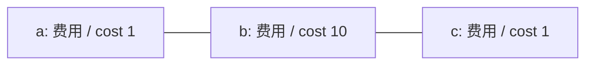
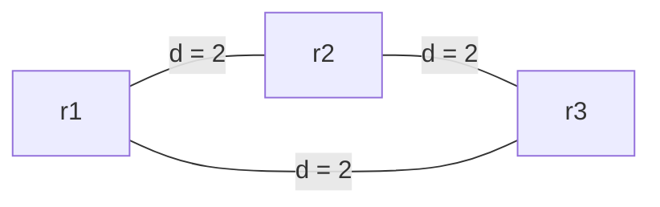
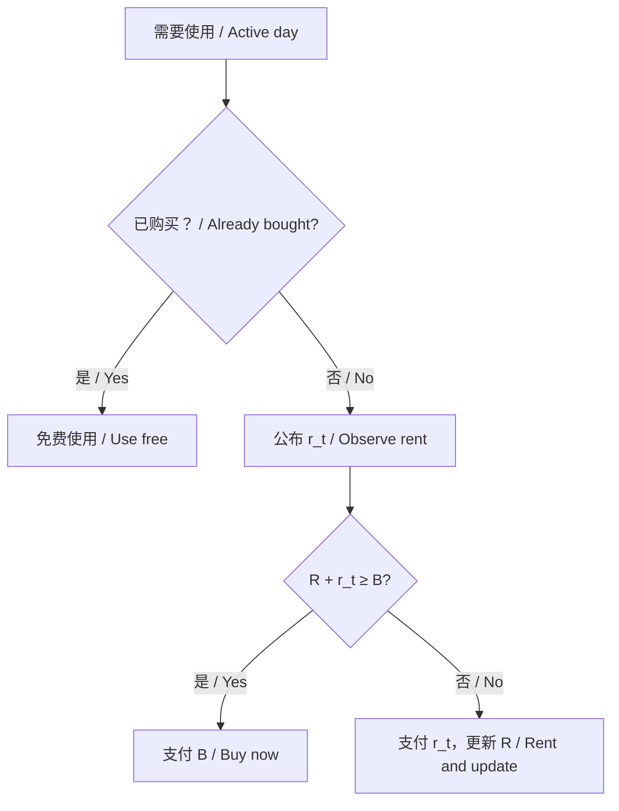
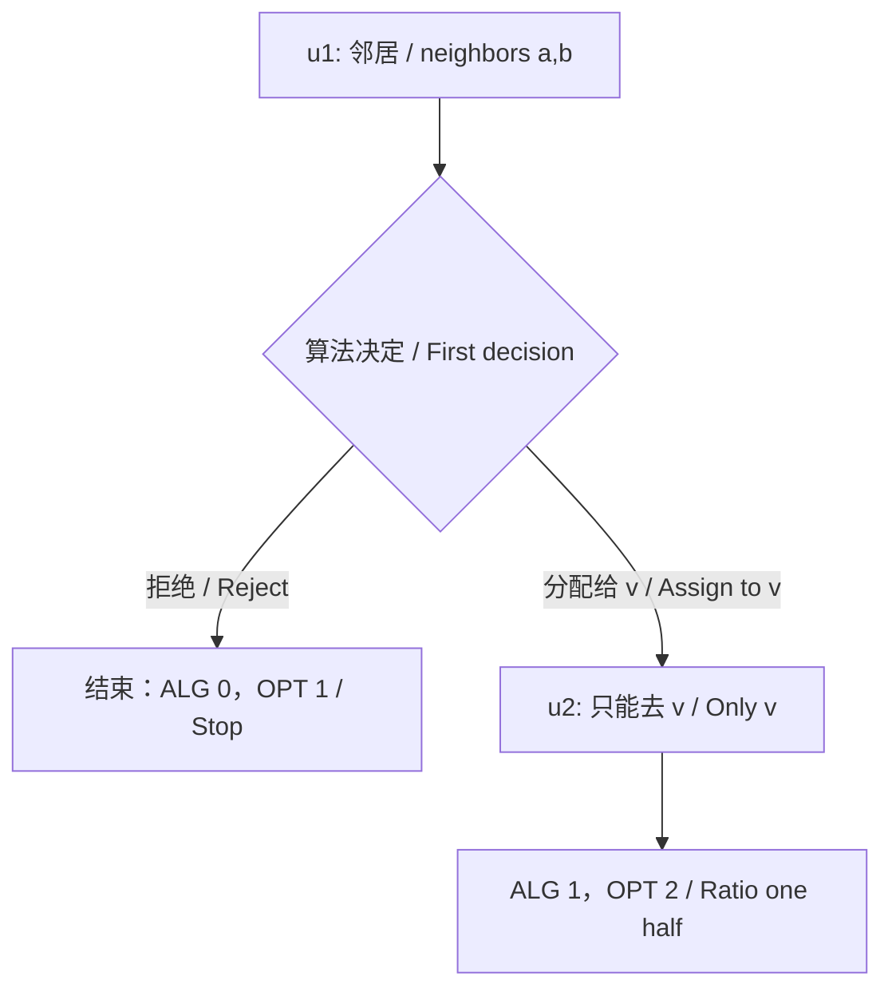

# CS6382 作业 1 零基础复习讲义 / Assignment 1 revision notes from first principles

_面向第一次学习算法分析的读者 / For readers studying algorithm analysis for the first time._

---

<a id="guide"></a>

## 📍 阅读指南 / Reading guide

**中文。** 本讲义覆盖作业 1 的六道题、27 个小问。每段先用中文解释，再给出对应英文；共用的公式放在两段之间或之后。建议第一次按顺序阅读，第二次沿“小问索引”复习证明，第三次遮住答案做自测。遇到不懂的符号，先回到基础部分，不必靠背公式继续读。

**English.** These notes cover all six questions and all 27 parts of Assignment 1. Chinese explanations precede their English counterparts, with shared formulas placed between or after them. Read sequentially first, revisit proofs using the part indexes second, and attempt the self-checks without looking at the answers third. Return to the foundations whenever a symbol is unfamiliar.

**中文。** 题目依据是[原始作业 PDF](../docs/CS6382_Assignment_1_Questions-1.pdf)，另有[中文题目](../docs/CS6382_Assignment_1_Questions-1.zh.md)与[英文题目](../docs/CS6382_Assignment_1_Questions-1.en.md)。[已有中文答案](../answers/CS6382_Assignment_1_Answers_Selected.zh.md)和[已有英文答案](../answers/CS6382_Assignment_1_Answers_Selected.en.md)覆盖第 1、2、6 题，可用于对照。本讲义的例子、解释与推导是学习材料；原题的假设始终优先。作业允许任选三题提交，这里仍讲解全部六题。

**English.** The source of the questions is the [original assignment PDF](../docs/CS6382_Assignment_1_Questions-1.pdf), with [Chinese](../docs/CS6382_Assignment_1_Questions-1.zh.md) and [English](../docs/CS6382_Assignment_1_Questions-1.en.md) transcriptions. Existing [Chinese answers](../answers/CS6382_Assignment_1_Answers_Selected.zh.md) and [English answers](../answers/CS6382_Assignment_1_Answers_Selected.en.md) cover Questions 1, 2, and 6. Examples and derivations here are instructional material; the original assumptions govern every solution. Although only three questions are required for submission, all six are covered here.

### 目录 / Contents

1. [先修基础 / Foundations](#foundations)
2. [问题 1：双资源背包 / Two-resource knapsack](#q1)
3. [问题 2：超图顶点覆盖 / Hypergraph vertex cover](#q2)
4. [问题 3：带权支配集 / Weighted dominating set](#q3)
5. [问题 4：Steiner 树 / Steiner tree](#q4)
6. [问题 5：租或买 / Rent-or-buy](#q5)
7. [问题 6：在线容量匹配 / Online matching with capacities](#q6)
8. [复习总表与术语 / Review tables and terminology](#review)

<a id="foundations"></a>

## 📚 先修基础 / Foundations

### 集合、下标与求和 / Sets, indices, and sums

**中文。** 集合是一组不重复的对象。例如 $A=\{1,2\}$、$O=\{2,3\}$。$u\in A$ 表示“$u$ 属于 $A$”；$A\subseteq O$ 表示“$A$ 的每个元素都在 $O$ 中”。空集 $\varnothing$ 没有元素。$|A|$ 表示元素个数，此处为 2。交集 $A\cap O=\{2\}$ 留下共同元素；并集 $A\cup O=\{1,2,3\}$ 合并元素；集合差 $O\setminus A=\{3\}$ 留下“在 $O$ 中但不在 $A$ 中”的元素。

**English.** A set is a collection of distinct objects. For example, let $A=\{1,2\}$ and $O=\{2,3\}$. Membership $u\in A$ means that $u$ belongs to $A$; inclusion $A\subseteq O$ means every element of $A$ belongs to $O$. The empty set $\varnothing$ has no elements. Cardinality $|A|$ counts elements and equals 2 here. Intersection gives $A\cap O=\{2\}$, union gives $A\cup O=\{1,2,3\}$, and difference gives $O\setminus A=\{3\}$.

**中文。** 下标只是标签：$v_i$ 是第 $i$ 个物品的价值，不是 $v$ 乘以 $i$。求和符号 $\sum$ 表示逐项相加。若 $S=\{1,3\}$，则 $\sum_{i\in S}v_i=v_1+v_3$。空集上的和为 0。大写集合 $S$ 与小写数值 $s$ 是不同对象；同一字母在不同题中也可能有不同含义。

**English.** A subscript is a label: $v_i$ is the value of item $i$, not $v$ multiplied by $i$. The symbol $\sum$ adds the indicated terms. If $S=\{1,3\}$, then $\sum_{i\in S}v_i=v_1+v_3$. An empty sum equals zero. An uppercase set $S$ differs from a lowercase number $s$, and a letter may have different meanings in different questions.

### 图、邻域、路径与树 / Graphs, neighborhoods, paths, and trees

**中文。** 图 $G=(V,E)$ 中，$V$ 是顶点集合，$E$ 是边集合；无向边 $uv$ 连接 $u$ 与 $v$，没有方向。“简单图”没有自环或重复边。顶点的度数是邻居数量，$\Delta$ 是全图最大度数。闭邻域 $N[v]$ 包含 $v$ 自己和它的邻居；例如路径 $a-b-c$ 中，$N[a]=\{a,b\}$、$N[b]=\{a,b,c\}$。第 6 题的 $N(u)$ 则是在线顶点可以分配到的离线邻居，不包含 $u$ 自己。

**English.** In a graph $G=(V,E)$, $V$ is the vertex set and $E$ the edge set. An undirected edge $uv$ joins $u$ and $v$ without orientation. A simple graph has no loops or parallel edges. The degree counts neighbors, and $\Delta$ is the maximum degree. A closed neighborhood $N[v]$ includes $v$ and its neighbors. On the path $a-b-c$, $N[a]=\{a,b\}$ and $N[b]=\{a,b,c\}$. In Question 6, $N(u)$ instead lists the offline vertices available to online vertex $u$ and does not include $u$.

**中文。** 路径是沿边连接的一串顶点，费用是边费用之和。环是绕一圈回到起点的闭合连接。连通表示任意两个顶点之间都能找到路径。树是连通且无环的图；有 $h$ 个顶点的树恰有 $h-1$ 条边。生成树连接给定图的全部顶点；最小生成树（MST）在所有生成树中费用最小。Steiner 树只要求连接指定终端，允许使用其他顶点。超图允许一条“超边”同时包含多个顶点，例如 $\{a,b,c\}$。

**English.** A path connects a sequence of vertices through edges, and its cost is the sum of their costs. A cycle closes back at its starting vertex. A graph is connected if every pair of vertices can be joined by a path. A tree is connected and acyclic; a tree on $h$ vertices has $h-1$ edges. A spanning tree includes all vertices of a given graph, and an MST has minimum cost among such trees. A Steiner tree must include designated terminals but may use additional vertices. In a hypergraph, an edge may contain several vertices, such as $\{a,b,c\}$.

**中文。** 为什么树有 $h-1$ 条边？从一个顶点开始沿树访问，每加入一个尚未访问的顶点，就使用一条连接它的边，共加入 $h-1$ 个顶点。若还有额外的边，它的两端已经通过访问所用的边连通，再加这条边就形成环，与树无环矛盾。因此这些连接边就是全部边。

**English.** Why does a tree have $h-1$ edges? Start at one vertex and traverse the tree, using one connecting edge for each newly visited vertex. There are $h-1$ new vertices. Any additional edge would join vertices already connected by traversal edges and create a cycle, contradicting acyclicity. Thus the connecting edges are all the edges.

### 变量、约束与松弛 / Variables, constraints, and relaxation

**中文。** 优化问题包含“可以决定的变量”“必须满足的约束”和“希望最大或最小的目标”。例如有两件价值分别为 4、7 的物品，$x_1,x_2$ 表示是否选择，目标是最大化 $4x_1+7x_2$。整数规划（IP）要求这里的 $x_i\in\{0,1\}$：0 是不选，1 是选。线性规划（LP）松弛允许 $0\le x_i\le1$，例如 $x_1=1/2$；它是用于分析的分数选择，不一定能直接执行。

**English.** An optimization problem specifies decision variables, constraints that must hold, and an objective to maximize or minimize. For two items valued at 4 and 7, selection variables $x_1,x_2$ give the objective $4x_1+7x_2$. The integer program requires $x_i\in\{0,1\}$, meaning omit or select. Its LP relaxation permits $0\le x_i\le1$, including $x_1=1/2$. Such fractional selections are analytical tools and need not be executable solutions.

**中文。** “松弛”扩大可行解的范围。因此最大化问题的 LP 最优值不会下降，是整数最优值的上界；最小化问题的 LP 最优值不会上升，是下界。$\mathrm{OPT}$ 是原问题的最优目标值，$\mathrm{OPT}_{LP}$ 是松弛最优值，$\mathrm{ALG}$ 是算法实际得到的目标值。它们表示数值，不是集合或算法本身。

**English.** Relaxation enlarges the feasible set. For maximization, the LP optimum cannot decrease and is an upper bound on the integer optimum. For minimization, it cannot increase and is a lower bound. The symbols $\mathrm{OPT}$, $\mathrm{OPT}_{LP}$, and $\mathrm{ALG}$ denote objective values of the original optimum, relaxed optimum, and algorithm output, respectively.

```math
\begin{array}{ll}
\text{Maximization:} & \mathrm{ALG}\le\mathrm{OPT}\le\mathrm{OPT}_{LP},\\
\text{Minimization:} & \mathrm{OPT}_{LP}\le\mathrm{OPT}\le\mathrm{ALG}.
\end{array}
```

### 极点与线性方程 / Extreme points and linear equations

**中文。** 这里一个“点” $x=(x_1,\ldots,x_n)$ 就是一组变量取值，每个 $x_i$ 叫一个坐标。一个集合是凸的，表示任意两个点之间的整段线都留在集合里。线性不等式定义的可行域是凸的，因为对两点的约束按比例相加，仍满足同样的约束。极点不能写成两个不同可行点的严格加权平均。例如正方形的角是极点，边的中点不是；若能沿某方向向前、向后各走一点且仍可行，原来的点就不是极点。

**English.** A point $x=(x_1,\ldots,x_n)$ is a list of variable values, with each $x_i$ called a coordinate. A set is convex if it contains the entire segment between every pair of its points. A region defined by linear inequalities is convex because weighted averages preserve those inequalities. An extreme point cannot be expressed as a strict weighted average of two distinct feasible points. A square's corners are extreme points, whereas an edge midpoint is not. If a point can be moved slightly in both directions while remaining feasible, it is not extreme.

```math
x=\lambda y+(1-\lambda)z,\qquad
0\lt\lambda\lt1,\quad y\ne z.
```

**中文。** 第 1 题只需一个线性代数事实：三个未知数满足两个齐次线性方程时，一定存在不全为零的解。“齐次”表示右边都是 0。“消元”是通过相加、相减或乘常数来去掉某个未知数；两个方程最多确定两个变量如何依赖其他变量，至少留一个可以自由选择的变量。把这个自由变量设成非零，再算出其他变量即可。即使两个方程重复，限制只会更少。这让我们找到“不改变资源总量”的扰动方向。

**English.** Question 1 needs only this linear-algebra fact: two homogeneous linear equations in three unknowns always have a nonzero solution. Homogeneous means both right-hand sides are zero. Elimination adds, subtracts, or scales equations to remove an unknown. Two equations can determine at most two variables in terms of others, leaving at least one variable free to choose. Choose that variable nonzero and solve for the others. Dependent equations leave even more freedom. This supplies a perturbation that preserves resource totals.

**中文。** 例如两个条件是 $d_1+d_2=0$、$d_2+d_3=0$。可以先取 $d_2=-1$，再得 $d_1=d_3=1$。所以方向 $d=(1,-1,1)$ 不为零，却使两个总和都不变。这只是示例；第 1(c) 按实际资源系数建立同类方程。

**English.** For example, if $d_1+d_2=0$ and $d_2+d_3=0$, choose $d_2=-1$ and obtain $d_1=d_3=1$. The direction $d=(1,-1,1)$ is nonzero while preserving both sums. This is illustrative; part 1(c) uses the actual resource coefficients in analogous equations.

### 近似、在线与竞争 / Approximation, online decisions, and competitiveness

**中文。** 近似算法在知道全部输入后，保证输出与最优值相差不超过一个比例。最大化问题的 3-近似意味着至少拿到最优值的三分之一；最小化问题的 3-近似意味着费用最多是最优值的三倍。先证明输出可行，再证明比例，最后说明运行时间。

**English.** An approximation algorithm sees the full input and guarantees a multiplicative relation to the optimum. A 3-approximation for maximization obtains at least one third of the optimum; for minimization, it costs at most three times the optimum. A proof should establish feasibility, the value bound, and polynomial running time.

```math
\begin{array}{ll}
\text{Maximization, factor }\rho\ge1: & \mathrm{ALG}\ge\mathrm{OPT}/\rho,\\
\text{Minimization, factor }\rho\ge1: & \mathrm{ALG}\le\rho\,\mathrm{OPT}.
\end{array}
```

**中文。** 在线算法只能看当前及过去的信息，必须立即决定；离线最优解知道整个未来。第 5 题用费用上界 $\mathrm{ALG}\le c\mathrm{OPT}$，$c$ 越小越好；第 6 题用收益下界 $\mathrm{ALG}\ge\alpha\mathrm{OPT}$，$\alpha$ 越大越好。两题都不允许加性常数。最坏比例可能只是无限接近某值，而没有单个输入达到该值；这仍能决定最小可保证的常数。

**English.** An online algorithm knows only the current and past information and must decide immediately. The offline optimum knows the entire future. Question 5 uses the cost guarantee $\mathrm{ALG}\le c\mathrm{OPT}$, where smaller $c$ is better; Question 6 uses the reward guarantee $\mathrm{ALG}\ge\alpha\mathrm{OPT}$, where larger $\alpha$ is better. Neither permits an additive constant. A worst-case ratio may be approached without being attained by any single input and still determine the best uniform guarantee.

### 四种证明方法与输入长度 / Four proof methods and input length

| 方法 / Method                | 怎么使用 / How it works                                                          | 本作业 / Here |
| ---------------------------- | -------------------------------------------------------------------------------- | ------------- |
| 反证 / Contradiction         | 假设结论失败，推出违反已知条件 / Assume failure and derive a violation           | 1(c), 2(b)    |
| 计数 / Counting              | 从两个角度统计同一对象 / Count the same objects in two ways                      | 2(d), 6(c)    |
| 收费 / Charging              | 分摊算法费用，再限制总收费 / Distribute algorithm cost and bound the charges     | 3(b)-(d)      |
| 对抗输入 / Adversarial input | 根据算法决定构造不利的后续 / Construct a harmful continuation from its decisions | 5(e), 6(e)    |

**中文。** 多项式时间针对的是输入的编码长度 $L$，即写下输入需要多少位，而不是数值本身有多大。若一个容量是 $2^{100}$，二进制只需 101 位；创建 $2^{100}$ 个副本却可能是指数规模。正有理数表示正的分数，输入同时给出分子和分母；证明运行时间时也应计入这些数字的位数。本讲义使用题目允许的 LP 求解事实，以及最短路和 MST 的标准多项式算法，不要求手工实现求解器。

**English.** Polynomial time is measured against the encoding length $L$, the number of bits needed to write the input, rather than the magnitudes of its numbers. A capacity $2^{100}$ takes 101 binary bits, but creating $2^{100}$ copies may require exponential work. Rational numbers are encoded by numerators and denominators, whose bit lengths also count. These notes use the LP-solving fact allowed by the assignment and standard polynomial algorithms for shortest paths and MSTs; implementing these solvers is unnecessary.

<a id="q1"></a>

## 🎯 问题 1：双资源背包 / Two-resource knapsack

小问索引 / Parts: [1(a)](#q1-a) · [1(b)](#q1-b) · [1(c)](#q1-c) · [1(d)](#q1-d)

### 题意、基础、例子与算法 / Setting, prerequisites, example, and algorithm

**中文。** 可以把两种资源想成背包的重量与体积。物品 $i$ 的价值为 $v_i$，重量、体积需求为 $a_i,b_i$，预算为 $A,B$；$n$ 是物品数。目标是选择价值最大的集合，同时满足两个预算。题目特别保证每一件物品单独都装得下，资源需求非负，价值为正。需要用到二元变量、松弛上界和极点扰动。

**English.** Think of the two resources as weight and volume. Item $i$ has value $v_i$ and requirements $a_i,b_i$, with budgets $A,B$; $n$ is the item count. We seek a maximum-value subset satisfying both budgets. Every singleton is feasible, resource demands are nonnegative, and values are positive. The main prerequisites are binary variables, LP upper bounds, and extreme-point perturbations.

**中文。** 例子：预算均为 1，两件物品价值均为 1，资源需求分别为 $(1,1/2)$ 和 $(1/2,1)$。整数解最多选一件；分数解却可以每件取 $2/3$，两种资源都恰好用完。算法因此先求一个最优 LP 极点，保留所有取值为 1 的物品得到 $S$，再找价值最大的单件 $j$，返回 $S$ 与 $\{j\}$ 中较好者。单件是防止舍入后价值全部丢失的保障。

**English.** With both budgets equal to 1, consider two unit-value items using $(1,1/2)$ and $(1/2,1)$. An integer solution selects at most one, but taking $2/3$ of each exactly fills both budgets. The algorithm finds an optimal LP extreme point, keeps all coordinates equal to 1 as $S$, finds a maximum-value item $j$, and returns the better of $S$ and $\{j\}$. The singleton protects against losing all value during rounding.

<a id="q1-a"></a>

### 1(a) 建模与 LP 上界 / Formulation and LP upper bound

**中文：目标与步骤。** 用一个开关 $x_i$ 表示物品是否被选中。价值相加成为目标，资源相加成为约束。先写整数规划，再只替换变量的取值范围；资源约束不变。

**English: goal and steps.** Use a switch $x_i$ to indicate selection. Add values in the objective and resource demands in the constraints. Formulate the integer program, then change only the variable domain to obtain its relaxation.

```math
\begin{aligned}
\max\quad & \sum_{i=1}^{n}v_i x_i\\
\text{subject to}\quad
& \sum_{i=1}^{n}a_i x_i\le A,\\
& \sum_{i=1}^{n}b_i x_i\le B,\\
& x_i\in\{0,1\}\quad(i=1,\ldots,n).
\end{aligned}
```

```math
\text{LP relaxation: replace }x_i\in\{0,1\}
\text{ by }0\le x_i\le1\quad(i=1,\ldots,n).
```

**中文：答题证明。** 每个整数可行解仍满足 LP 的约束，因此 LP 可以选择原来的整数最优解，也可以选择其他分数解。最大化时多一些选择不会降低最优值，故 $\mathrm{OPT}\le\mathrm{OPT}_{LP}$。

**English: compact proof.** Every integer-feasible solution remains LP-feasible. The LP can choose the integer optimum as well as additional fractional solutions. Enlarging the feasible set of a maximization problem cannot decrease its optimum, so $\mathrm{OPT}\le\mathrm{OPT}_{LP}$.

<a id="q1-b"></a>

### 1(b) 最优分数解与舍入失败 / Fractional optimum and rounding failure

**中文：整数部分。** 两件一起选时，每种资源都需要 $1+\delta\gt1$，不可行。任一单件可行、价值为 1，空集价值为 0，所以整数最优值为 1；两个单件都是最优解，整数最优解并不唯一。

**English: integer part.** Selecting both items consumes $1+\delta\gt1$ of each resource and is infeasible. Either singleton is feasible with value 1, whereas the empty set has value 0. Hence the integer optimum is 1, attained by either singleton; it is not unique.

**中文：先界定，再达到。** LP 约束相加给出目标值的上界。令两个变量均为 $1/(1+\delta)$，它们在 0 与 1 之间，且两条资源约束同时取等，达到上界，所以最优。

**English: bound and attainment.** Adding the LP constraints bounds the objective. Setting both variables to $1/(1+\delta)$ gives values strictly between 0 and 1 and makes both resource constraints tight. It attains the bound and is optimal.

```math
\begin{aligned}
x_1+\delta x_2&\le1,\qquad \delta x_1+x_2\le1,\\
(1+\delta)(x_1+x_2)&\le2,\\
x_1^*=x_2^*&=\frac{1}{1+\delta},\qquad
\mathrm{OPT}_{LP}=\frac{2}{1+\delta}.
\end{aligned}
```

**中文：唯一性。** 任意最优解都必须让相加后的约束取等。每条约束左边都不超过 1，总和等于 2 意味着两条都等于 1。相减得到 $(1-\delta)(x_1-x_2)=0$；因为 $1-\delta\gt0$，必须 $x_1=x_2$，代回即得到上述唯一解。两个变量都是分数，全部向下取整得到 $(0,0)$，价值为 0。因此单纯向下取整不能保证任何有限近似因子。

**English: uniqueness and failure.** Every optimum must attain equality in the summed constraint. Since each original left-hand side is at most 1, a sum of 2 forces both constraints to be tight. Subtracting gives $(1-\delta)(x_1-x_2)=0$. As $1-\delta\gt0$, we obtain $x_1=x_2$, and substitution yields the unique solution above. Both coordinates are fractional, so rounding both down gives $(0,0)$ of value 0. Pure downward rounding therefore has no finite approximation factor.

**中文 / English：数值检查 / Numerical check。** $\delta=1/2$ 时，每个分数为 $2/3$，LP 值为 $4/3$，整数值为 1，舍入值为 0。/ For $\delta=1/2$, the fractions are $2/3$, the LP value is $4/3$, the integer value is 1, and the rounded value is 0.

<a id="q1-c"></a>

### 1(c) 极点至多有两个分数变量 / At most two fractional coordinates

**中文：目标与直觉。** 分数变量表示 $0\lt x_i\lt1$。要证明极点不可能有三个这样的坐标。三个可调整的数只有两种资源总量需要保持，必能找到一个非零调整方向。向这个方向和反方向各走一点，原点就成为两个可行点的中点，与极点性质冲突。

**English: goal and intuition.** A fractional coordinate satisfies $0\lt x_i\lt1$. Three adjustable coordinates with only two resource totals to preserve leave a nonzero direction of movement. Small movements in both directions would make the original point the midpoint of two feasible points, contradicting extremality.

**中文：找方向。** 假设极点 $x$ 有三个分数坐标，标签为 $i_1,i_2,i_3$。在它们上解下面两个齐次方程，其余坐标令 $d_i=0$。三个未知数、两个方程必有非零解 $d$。不要求两条资源约束原本取等：保持总量不变足以保持可行性。

**English: construct the direction.** Suppose an extreme point $x$ has fractional coordinates $i_1,i_2,i_3$. Solve these two homogeneous equations on those coordinates and set all other $d_i$ to zero. Three unknowns and two equations admit a nonzero solution $d$. The original resource inequalities need not be tight: preserving their totals preserves feasibility.

```math
\sum_{h=1}^{3}a_{i_h}d_{i_h}=0,\qquad
\sum_{h=1}^{3}b_{i_h}d_{i_h}=0.
```

**中文：保证不越界。** 每个被改变的坐标都与 0、1 有正距离，因此可以选一个足够小的正数 $\eta$，满足下式。分母为零的坐标不参与最小值；$d\ne0$ 保证至少有一项。这样 $x+\eta d$ 与 $x-\eta d$ 的每个坐标都在 $[0,1]$ 内，资源总量也不变。

**English: stay within the bounds.** Each changing coordinate has a positive distance from 0 and 1. Choose a positive $\eta$ satisfying the following bound, omitting zero denominators. Since $d\ne0$, the minimum has at least one term. Both perturbed points remain in $[0,1]^n$ and have unchanged resource totals.

```math
0\lt\eta\lt
\min_{i:d_i\ne0}\frac{\min\{x_i,1-x_i\}}{|d_i|},\qquad
x=\frac{(x+\eta d)+(x-\eta d)}{2}.
```

**中文：答题证明。** 上述两个点可行且互异，$x$ 是它们的中点，矛盾。因此每个极点至多有两个分数坐标。这只证明极点的性质；任意可行解或任意最优解不一定满足该结论。

**English: compact conclusion.** The two perturbed points are distinct and feasible, and their midpoint is $x$, a contradiction. Every extreme point therefore has at most two fractional coordinates. The claim concerns extreme points, not arbitrary feasible or optimal solutions.

<a id="q1-d"></a>

### 1(d) 可行性、3-近似与时间 / Feasibility, 3-approximation, and time

**中文：可行性。** 令 $x^*$ 是最优极点，$S=\{i:x_i^*=1\}$，$j$ 为价值最大物品，$F=\{i:0\lt x_i^*\lt1\}$。把分数坐标变成 0 后，两种资源消耗只会减少，因为 $a_i,b_i\ge0$，所以 $S$ 可行。题设保证 $\{j\}$ 可行，返回较好者也可行。

**English: feasibility.** Let $x^*$ be an optimal extreme point, $S=\{i:x_i^*=1\}$, $j$ a maximum-value item, and $F=\{i:0\lt x_i^*\lt1\}$. Replacing fractional coordinates by zero cannot increase either resource total because $a_i,b_i\ge0$, so $S$ is feasible. The singleton $\{j\}$ is feasible by assumption, hence the better candidate is feasible.

**中文：比例推导。** 第一个不等式来自松弛上界；等式把 LP 价值分成完整物品与分数物品。由于 $|F|\le2$、$x_i^*\le1$ 且 $v_i\le v_j$，分数部分至多损失 $2v_j$。最后，$v(S)$ 和 $v_j$ 各自都不超过两者最大值。

**English: value bound.** The first inequality uses the LP upper bound. The equality separates integral and fractional contributions. Since $|F|\le2$, $x_i^*\le1$, and $v_i\le v_j$, the fractional contribution is at most $2v_j$. Finally, each candidate value is at most their maximum.

```math
\begin{aligned}
\mathrm{OPT}
&\le\mathrm{OPT}_{LP}
=v(S)+\sum_{i\in F}v_i x_i^*\\
&\le v(S)+2v_j\\
&\le3\max\{v(S),v_j\}
=3\mathrm{ALG}.
\end{aligned}
```

**中文：答题结论与时间。** 因而 $\mathrm{ALG}\ge\mathrm{OPT}/3$，是 3-近似。零向量可行，且所有变量有界，LP 非空且有界；其有理系数显式给出，可以使用题目提供的事实在多项式时间找到最优极点。随后扫描物品、计算价值和比较候选也只需多项式时间。

**English: conclusion and running time.** Thus $\mathrm{ALG}\ge\mathrm{OPT}/3$, proving a 3-approximation. The zero vector is feasible and every variable is bounded, so the rational LP is nonempty and bounded. The allowed fact finds an optimal extreme point in polynomial time. Scanning items, summing values, and comparing candidates also take polynomial time.

### 易错点与自测 / Pitfalls and self-checks

**中文。** 不要把 LP 分数解直接当成可选物品；不要对任意最优解使用极点结论；不要省略单件可行的假设；3-近似是至少获得三分之一，不是获得三倍价值。

**English.** Fractional LP selections are not directly executable item choices. The extreme-point property does not hold for every optimal solution. Singleton feasibility is essential. A 3-approximation guarantees at least one third of the optimum, not three times its value.

1. **问题 / Question：** 若最优极点没有分数变量，算法是否精确？/ Is the algorithm exact if the optimal extreme point is integral?
   **答案 / Answer：** 是。$S$ 的价值等于 $\mathrm{OPT}_{LP}$；因 $S$ 整数可行且 LP 是上界，必有 $v(S)=\mathrm{OPT}$。/ Yes. The integer-feasible set $S$ attains the LP upper bound, so $v(S)=\mathrm{OPT}$.
2. **问题 / Question：** 第 1(b) 的 $\delta=1/2$ 例子中，最终算法返回多少价值？/ What value does the final algorithm return in part (b) with $\delta=1/2$?
   **答案 / Answer：** $S$ 为空，但最大单件价值为 1，因此返回 1，恰好最优。/ The rounded set is empty, but the best singleton has value 1, so the output is 1 and is optimal.

<a id="q2"></a>

## 🎯 问题 2：超图顶点覆盖 / Hypergraph vertex cover

小问索引 / Parts: [2(a)](#q2-a) · [2(b)](#q2-b) · [2(c)](#q2-c) · [2(d)](#q2-d)

### 题意、基础、例子与算法 / Setting, prerequisites, example, and algorithm

**中文。** 可以把每条超边看成一项任务，把顶点看成可购买的服务。每项任务至少需要它对应超边中的一个服务。$V$ 是服务集合，$\mathcal E$ 是显式列出的非空超边集合，$c_v\gt0$ 是服务费用，每条超边大小最多为 $r$。目标是花最少的钱，让每条超边都碰到所选集合 $C$。这里覆盖的是超边；第 3 题支配集覆盖的则是顶点。

**English.** View each hyperedge as a task and each vertex as a purchasable service. A task needs at least one service from its hyperedge. The set $V$ contains services, $\mathcal E$ explicitly lists nonempty hyperedges, $c_v\gt0$ is a service cost, and each hyperedge has at most $r$ vertices. We seek a minimum-cost set $C$ intersecting every hyperedge. Here we cover hyperedges; dominating set in Question 3 covers vertices.

**中文。** 例子：$V=\{a,b,c,d\}$，超边为 $\{a,b,c\}$ 与 $\{c,d\}$，$r=3$。选择 $c$ 就能覆盖两条超边。LP 可以给 $a,b,c$ 各分配 $1/3$，给 $d$ 分配 $2/3$，这是一个可行分数解，不声称它对任意费用都是最优。算法求最优 LP 解后，选择所有 $x_v^*\ge1/r$ 的顶点，包括恰好等于阈值的顶点。

**English.** For $V=\{a,b,c,d\}$ with hyperedges $\{a,b,c\}$ and $\{c,d\}$ and $r=3$, selecting $c$ covers both edges. The fractional assignment $x_a=x_b=x_c=1/3$, $x_d=2/3$ is feasible, though not necessarily optimal for arbitrary costs. The algorithm solves the LP and selects every vertex with $x_v^*\ge1/r$, including equality.

<a id="q2-a"></a>

### 2(a) 建模与 LP 下界 / Formulation and LP lower bound

**中文：步骤。** $x_v=1$ 表示购买顶点 $v$。每条超边至少选一个，所以该边上的变量之和至少为 1。费用为所选顶点费用之和。

**English: steps.** Set $x_v=1$ when vertex $v$ is selected. At least one vertex must be selected from each edge, so its variable sum must be at least 1. The objective adds selected vertex costs.

```math
\begin{aligned}
\min\quad & \sum_{v\in V}c_vx_v\\
\text{subject to}\quad
& \sum_{v\in e}x_v\ge1\quad(e\in\mathcal E),\\
& x_v\in\{0,1\}\quad(v\in V).
\end{aligned}
```

```math
\text{LP relaxation: }0\le x_v\le1\quad(v\in V),\qquad
\mathrm{OPT}_{LP}\le\mathrm{OPT}.
```

**中文：答题证明。** LP 包含全部整数可行解，因此最小化时可以花同样多的钱，或借分数选择花更少的钱，不能花得更多。故 LP 最优值是原最优值的下界。

**English: compact proof.** Every integer solution remains LP-feasible. Minimizing over this larger set can cost the same or less, but cannot cost more. Therefore the LP optimum is a lower bound on the original optimum.

<a id="q2-b"></a>

### 2(b) 阈值舍入为什么覆盖每条边 / Why threshold rounding covers every edge

**中文：直觉与反证。** 一条超边最多有 $r$ 个数，总和至少为 1，其中必有一个数至少为 $1/r$。正式地，设 $C=\{v:x_v^*\ge1/r\}$；假设某条非空超边 $e$ 没有被覆盖，则所有 $v\in e$ 都满足 $x_v^*\lt1/r$。逐项相加得到下式，违反 LP 约束。

**English: intuition and contradiction.** At most $r$ numbers summing to at least 1 must include a number at least $1/r$. Formally, let $C=\{v:x_v^*\ge1/r\}$. If a nonempty edge $e$ were uncovered, every $v\in e$ would satisfy $x_v^*\lt1/r$. Summing gives the following contradiction to LP feasibility.

```math
\sum_{v\in e}x_v^*\lt\frac{|e|}{r}\le1,
\qquad\text{but LP feasibility requires }\sum_{v\in e}x_v^*\ge1.
```

**中文 / English：结论 / Conclusion。** 因而 $C$ 与每条超边相交，是可行覆盖。/ Thus $C$ intersects every hyperedge and is a feasible cover.

<a id="q2-c"></a>

### 2(c) 费用至多放大 r 倍 / Cost increases by at most a factor r

**中文：逐项比较。** 对一个被选顶点，$x_v^*\ge1/r$，所以 $c_v\le r c_vx_v^*$。它的整数费用最多是 LP 对它支付费用的 $r$ 倍。对所有被选顶点求和，再加上未选顶点的非负 LP 费用，最后使用松弛下界。

**English: termwise comparison.** For each selected vertex, $x_v^*\ge1/r$, so $c_v\le r c_vx_v^*$. Its integral cost is at most $r$ times its LP contribution. Sum over selected vertices, include the nonnegative contributions of unselected vertices, and use the LP lower bound.

```math
\begin{aligned}
c(C)
&=\sum_{v\in C}c_v
\le r\sum_{v\in C}c_vx_v^*\\
&\le r\sum_{v\in V}c_vx_v^*
=r\mathrm{OPT}_{LP}
\le r\mathrm{OPT}.
\end{aligned}
```

**中文：答题结论与时间。** 第 2(b) 证明可行，上式证明 $r$-近似。全选向量可行，变量有界；有理 LP 的规模关于显式输入长度是多项式，可在多项式时间求解。随后只需扫描顶点比较阈值。如果没有超边，空集最优且最优 LP 解为零，算法同样返回空集。

**English: conclusion and time.** Part (b) establishes feasibility, and the bound proves an $r$-approximation. Selecting every vertex is LP-feasible, and variables are bounded. The rational LP has polynomial size in the explicitly listed input and can be solved in polynomial time; rounding scans the vertices. If there are no hyperedges, the empty set and zero LP vector are optimal, and rounding returns the empty set.

<a id="q2-d"></a>

### 2(d) 完全 r 元超图与整数性间隙 / Complete r-uniform hypergraph and gap

**中文：整数最优值。** 此处每个 $r$ 元子集都是超边，费用均为 1。用补集来想：如果没选的顶点至少有 $r$ 个，这些顶点中就有一条完全未覆盖的超边。因此最多漏掉 $r-1$ 个，至少选 $n-r+1$ 个。反过来，任选 $n-r+1$ 个后，补集只有 $r-1$ 个，不可能包含一整条 $r$ 元超边，所以可行。

**English: integer optimum.** Every $r$-element subset is an edge and every cost is 1. If at least $r$ vertices are omitted, they contain an uncovered edge. Thus at most $r-1$ may be omitted, requiring at least $n-r+1$ selections. Conversely, selecting any $n-r+1$ vertices leaves only $r-1$ outside the cover, which cannot contain an entire edge. Therefore this bound is attained.

```math
\mathrm{OPT}=n-r+1.
```

**中文：LP 上界。** 令每个 $x_v=1/r$，每条边的和为 1，可行且总费用为 $n/r$。这一步只说明最小 LP 费用不超过 $n/r$，还必须证明不能更小。

**English: LP upper bound.** Setting every $x_v=1/r$ gives sum 1 on each edge and total cost $n/r$. This proves the minimum LP cost is at most $n/r$; a lower bound is still needed to establish optimality.

**中文：计数下界。** $\binom{n}{r}$ 读作“从 $n$ 个不同元素中选 $r$ 个的方式数”，等于 $n!/[r!(n-r)!]$；$n!=1\cdot2\cdots n$，$0!=1$。共有 $\binom nr$ 条边。固定顶点 $v$ 后，包含它的边还需从其他 $n-1$ 个顶点中选 $r-1$ 个，所以 $x_v$ 在全部约束之和中出现 $\binom{n-1}{r-1}$ 次。将所有约束相加并除以这个正数：

**English: counting lower bound.** The binomial coefficient $\binom nr=n!/[r!(n-r)!]$ counts the ways to choose $r$ elements from $n$, where $n!=1\cdot2\cdots n$ and $0!=1$. There are $\binom nr$ edges. An edge containing a fixed vertex chooses its remaining $r-1$ vertices from the other $n-1$, so every $x_v$ appears $\binom{n-1}{r-1}$ times in the summed constraints. Summing and dividing by that positive number yields:

```math
\binom{n-1}{r-1}\sum_{v\in V}x_v\ge\binom nr,
\qquad
\sum_{v\in V}x_v\ge
\frac{\binom nr}{\binom{n-1}{r-1}}=\frac nr.
```

**中文：答题结论。** 可行解达到下界，因此 LP 最优值恰为 $n/r$。固定 $r$ 时，下式中的 $(r-1)/n$ 趋于 0，比例趋于 $r$。这是一族实例中整数最优值与该 LP 最优值的差距，说明该松弛可以低估最优费用接近 $r$ 倍；它没有证明所有多项式算法都做不到更好。排除更好的算法需要另外的困难性论证。

**English: compact conclusion.** A feasible solution attains the lower bound, so the LP optimum is exactly $n/r$. For fixed $r$, the term $(r-1)/n$ tends to zero and the ratio approaches $r$. This measures the gap between the integer optimum and this LP relaxation, which can underestimate integral cost by a factor approaching $r$. It does not establish a lower bound against all polynomial algorithms; that would require a separate hardness argument.

```math
\mathrm{OPT}_{LP}=\frac nr,\qquad
\frac{\mathrm{OPT}}{\mathrm{OPT}_{LP}}
=r\left(1-\frac{r-1}{n}\right)\longrightarrow r.
```

### 易错点与自测 / Pitfalls and self-checks

**中文。** 阈值用“至少”而不是“严格大于”；最小化时 LP 是下界；给出一个分数解不足以证明 LP 最优；当 $n=r$ 时公式仍有效。超边即使很多，时间也针对列出全部超边后的输入长度计算。

**English.** Include equality in the threshold. The LP is a lower bound for minimization. Exhibiting a fractional solution alone does not prove optimality. The formulas also hold at $n=r$. Even with many edges, running time is measured against the input length that explicitly lists them all.

1. **问题 / Question：** $n=5,r=3$ 时，整数值、LP 值和间隙是多少？/ What are the integer value, LP value, and gap for $n=5,r=3$?
   **答案 / Answer：** 分别是 $3$、$5/3$、$9/5$；例如漏掉两个顶点仍可覆盖所有三元超边。/ They are $3$, $5/3$, and $9/5$; omitting two vertices still covers every triple.
2. **问题 / Question：** 一条含 $r$ 个顶点的边，每个变量恰为 $1/r$；若改用严格大于阈值会怎样？/ What if strict thresholding is used on an edge whose $r$ variables all equal $1/r$?
   **答案 / Answer：** 全部被排除，该边未覆盖，尽管 LP 约束成立。/ All vertices are excluded, leaving the edge uncovered despite LP feasibility.

<a id="q3"></a>

## 🎯 问题 3：带权支配集 / Weighted dominating set

小问索引 / Parts: [3(a)](#q3-a) · [3(b)](#q3-b) · [3(c)](#q3-c) · [3(d)](#q3-d)

### 题意、基础、例子与算法 / Setting, prerequisites, example, and algorithm

**中文。** 选择顶点 $v$，支付 $c_v$，就能照顾闭邻域 $N[v]$ 中的全部顶点，包括它自己。希望让全图被照顾，总费用最小。$D$ 是已选顶点集合，$U$ 是尚未被支配的顶点集合，$\Delta$ 是最大度数。需要闭邻域、集合交集、贪心选择和收费分析。可以把它看成集合覆盖：每个候选集合是 $N[v]$，费用是 $c_v$。

**English.** Selecting vertex $v$ costs $c_v$ and dominates every vertex in its closed neighborhood $N[v]$, including itself. We seek minimum total cost while dominating the whole graph. The set $D$ contains selected vertices, $U$ contains undominated vertices, and $\Delta$ is the maximum degree. The proof uses closed neighborhoods, intersections, greedy selection, and charging. Equivalently, this is set cover with candidate sets $N[v]$ of cost $c_v$.

**中文。** 算法从 $U=V,D=\varnothing$ 开始。每次计算“费用 / 新覆盖顶点数”，在分母为正的顶点中取最小者 $w$，加入 $D$，再更新 $U\leftarrow U\setminus N[w]$。$w$ 表示这一步实际选中的顶点；后面证明里固定的 $v$ 不一定被算法选择。平局任意打破，保证仍成立。

**English.** Start with $U=V,D=\varnothing$. At each step, minimize cost divided by newly dominated vertices among positive denominators, select a minimizer $w$, add it to $D$, and update $U\leftarrow U\setminus N[w]$. Here $w$ is the actual choice, whereas the fixed vertex $v$ used later in the proof need not be selected. Ties may be broken arbitrarily.

**中文。** 小例子用路径 $a-b-c$，端点费用均为 1，中心费用为 10。中心能一次覆盖三个顶点，但平均费用为 $10/3$；端点各覆盖两个，平均费用为 $1/2$，更划算。

**English.** On the path $a-b-c$, give the endpoints cost 1 and the center cost 10. The center covers three vertices at average cost $10/3$, whereas either endpoint covers two at average cost $1/2$ and is cheaper per newly covered vertex.



<a id="q3-a"></a>

### 3(a) 忽略费用的无界反例 / Unbounded failure when costs are ignored

**中文：构造与分析。** 仍用三顶点路径，令 $c_a=c_c=1,c_b=K$，其中 $K\gt2$。初始时中心 $b$ 唯一能覆盖三个顶点，端点各只能覆盖两个。因此忽略费用的启发式必选 $b$，花费 $K$ 并结束。只选一个端点无法覆盖另一端点；若不选中心，就必须选两个端点，花费 2。所以 $\mathrm{OPT}=\min\{K,2\}=2$，启发式比值为 $K/2$。

**English: construction and analysis.** Use the three-vertex path with $c_a=c_c=1$ and $c_b=K\gt2$. The center uniquely dominates three vertices initially, while each endpoint dominates only two. The cost-blind heuristic therefore selects $b$, pays $K$, and finishes. A single endpoint cannot dominate the opposite endpoint. Any dominating set excluding the center must contain both endpoints, costing 2. Thus $\mathrm{OPT}=\min\{K,2\}=2$ and the ratio is $K/2$.

**中文：答题结论。** 对任何希望超过的常数 $L\gt0$，选有理数 $K\gt\max\{2,2L\}$ 即使比值超过 $L$，故近似比可任意大，不依赖平局处理。

**English: compact conclusion.** For any target constant $L\gt0$, choose rational $K\gt\max\{2,2L\}$. The ratio then exceeds $L$, proving unbounded approximation ratio without relying on tie-breaking.

<a id="q3-b"></a>

### 3(b) 分摊费用恰好等于总费用 / Charges exactly account for total cost

**中文：解释与例子。** 某一步选 $w$，新覆盖 $q=|N[w]\cap U|$ 个顶点，把费用平均分成 $q$ 份，每个新顶点收 $p_u=c_w/q$。这只是证明中的账本，不是额外收费。上述费用为 10 的例子，若先选 $a$，它新覆盖 $a,b$，价格各为 $1/2$；再选 $c$，它只新覆盖 $c$，价格为 1。总价格为 2，等于所选顶点费用。

**English: interpretation and example.** If a step selects $w$ and newly dominates $q=|N[w]\cap U|$ vertices, divide its cost into $q$ equal charges $p_u=c_w/q$. These are accounting values for the proof, not extra payments. In the cost-10 example, selecting $a$ first charges $1/2$ each to $a,b$; selecting $c$ next newly dominates only $c$ and charges it 1. The total charge is 2, equal to the selected-vertex cost.

| 步骤 / Step | 所选 / Choice | 新覆盖 / Newly dominated | 每点价格 / Price each | 本步总价 / Step charge |
| ----------- | ------------- | ------------------------ | --------------------- | ---------------------- |
| 1           | $a$         | $a,b$                  | $1/2$               | $1$                  |
| 2           | $c$         | $c$                    | $1$                 | $1$                  |

**中文：答题证明。** 每步新覆盖顶点的总价格为 $q(c_w/q)=c_w$。顶点一旦从 $U$ 删除，就不再收费；结束时所有顶点都恰好被收费一次。所选顶点也不会重复：选过 $w$ 后，它的闭邻域已没有未覆盖顶点，分母为零，不再是候选。对各步求和便得到：

**English: compact proof.** The new vertices at a step receive total charge $q(c_w/q)=c_w$. Once removed from $U$, a vertex is never charged again, and every vertex is charged exactly once by termination. A selected vertex cannot be selected again because its entire neighborhood has been removed from $U$, making its denominator zero. Summing over steps gives:

```math
c(D)=\sum_{u\in V}p_u.
```

<a id="q3-c"></a>

### 3(c) 一个闭邻域的收费上界 / Bounding charges within one neighborhood

**中文：目标与时间点。** 固定任意顶点 $v$，其闭邻域大小为 $s=|N[v]|$。按被覆盖时间排列 $u_1,\ldots,u_s$，同一步中的顺序任意。看 $u_j$ 被覆盖的那一步开始之前：$u_j,\ldots,u_s$ 当时都未被覆盖，所以 $|N[v]\cap U|\ge s-j+1$。若其中一些与 $u_j$ 同步覆盖，它们在这一步之前也都还在 $U$，因此不等式依然成立。

**English: goal and timing.** Fix any vertex $v$ with $s=|N[v]|$ and order its neighbors $u_1,\ldots,u_s$ by domination time, breaking simultaneous ties arbitrarily. Immediately before the step dominating $u_j$, all of $u_j,\ldots,u_s$ are undominated, so $|N[v]\cap U|\ge s-j+1$. Vertices dominated simultaneously with $u_j$ are also still in $U$ before the step, so ties do not invalidate this bound.

**中文：用贪心比较。** 这一步选的是 $w$，但 $v$ 的分母为正，也是候选。因为算法取最小单位费用，$w$ 的单位费用不超过 $v$ 的。第二个不等式用“分母越大，正分数越小”。

**English: compare with the greedy choice.** The step chooses $w$, but $v$ is an eligible candidate because its denominator is positive. Greedy's minimum cost per new vertex is no greater than $v$'s. The second inequality uses that increasing a positive denominator decreases the fraction.

```math
p_{u_j}=\frac{c_w}{|N[w]\cap U|}
\le\frac{c_v}{|N[v]\cap U|}
\le\frac{c_v}{s-j+1}.
```

**中文：求和。** $j$ 从 1 到 $s$ 时，分母依次为 $s,s-1,\ldots,1$。倒过来相加就是调和数 $H_s$。例如 $H_1=1$、$H_2=3/2$、$H_3=11/6$。收费上界不是说每个点都实际收到这些价格，而是逐项至多这么多。

**English: sum the bounds.** As $j$ runs from 1 to $s$, the denominators are $s,s-1,\ldots,1$, whose reciprocal sum is the harmonic number $H_s$. For example, $H_1=1$, $H_2=3/2$, and $H_3=11/6$. These are upper bounds on individual charges, not necessarily their actual values.

```math
\sum_{u\in N[v]}p_u
=\sum_{j=1}^{s}p_{u_j}
\le c_v\sum_{j=1}^{s}\frac{1}{s-j+1}
=H_s c_v,\qquad H_s=\sum_{j=1}^{s}\frac1j.
```

<a id="q3-d"></a>

### 3(d) 用最优解汇总收费 / Sum charges using an optimal solution

**中文：核心思路。** 令 $D^*$ 是最优支配集。其闭邻域覆盖 $V$，所以每个 $p_u$ 至少在 $\sum_{v\in D^*}\sum_{u\in N[v]}p_u$ 中出现一次，可能出现多次。所有价格非负，重复计数只会增加总和；这里必须写不等式而不是等式。又因为 $|N[v]|\le\Delta+1$，调和数随下标增加而增加，可以统一使用 $H_{\Delta+1}$。

**English: central idea.** Let $D^*$ be an optimal dominating set. Its closed neighborhoods cover $V$, so every charge appears at least once in the double sum over $v\in D^*$. It may appear several times. Nonnegative charges make repeated counting increase the sum, so this step is an inequality, not an equality. Since $|N[v]|\le\Delta+1$ and harmonic numbers increase with their index, use the common bound $H_{\Delta+1}$.

```math
\begin{aligned}
c(D)
&=\sum_{u\in V}p_u
\le\sum_{v\in D^*}\sum_{u\in N[v]}p_u\\
&\le\sum_{v\in D^*}H_{|N[v]|}c_v
\le H_{\Delta+1}\sum_{v\in D^*}c_v\\
&=H_{\Delta+1}\mathrm{OPT}.
\end{aligned}
```

**中文：可行性与时间。** 只要 $U$ 非空，其中任意 $u$ 的闭邻域含自己，故至少有一个正分母候选。每步删除至少一个未覆盖顶点，最多 $|V|$ 步结束，此时 $D$ 支配全部顶点。朴素实现每步检查所有闭邻域并计算交集大小，足以达到多项式时间。比较有理费用比时可交叉相乘，不需要用浮点近似。若图无边，$\Delta=0$，每步选一个顶点，$H_1=1$，算法精确；空图则直接返回空集。

**English: feasibility and running time.** Whenever $U$ is nonempty, any $u\in U$ belongs to its own closed neighborhood, so an eligible candidate exists. Every step removes at least one vertex and there are at most $|V|$ steps; the final set dominates all vertices. Scanning all closed neighborhoods and recomputing intersection sizes each step is polynomial. Rational ratios can be compared by cross-multiplication rather than floating-point approximation. For a nonempty edgeless graph, $\Delta=0$ and $H_1=1$, so selecting every vertex is exact. An empty graph returns the empty set immediately.

**中文 / English：答题结论 / Compact conclusion。** 可行性、收费不等式和多项式时间共同证明算法为 $H_{\Delta+1}$-近似。/ Feasibility, the charging bound, and polynomial running time establish an $H_{\Delta+1}$-approximation.

### 易错点与自测 / Pitfalls and self-checks

**中文。** 分母只数新覆盖顶点；闭邻域包含自己，所以界为 $\Delta+1$；固定的比较顶点 $v$ 不必被选择；同一步价格相同但排序可任意；最优闭邻域可能重叠，汇总时只能保证不等式。

**English.** Count only newly dominated vertices in the denominator. Closed neighborhoods include the vertex itself, producing $\Delta+1$. The comparison vertex $v$ need not be selected. Simultaneous vertices share a charge but may be ordered arbitrarily. Optimal neighborhoods may overlap, so their charge sum is an upper bound rather than an exact partition.

1. **问题 / Question：** 路径例子中，选 $a$ 后再选 $c$，第二步分母是 1 还是 2？/ After selecting $a$, is the denominator for $c$ equal to 1 or 2?
   **答案 / Answer：** 是 1；$N[c]=\{b,c\}$，但 $b$ 已覆盖，只有 $c$ 留在 $U$ 中。/ It is 1: $N[c]=\{b,c\}$, but only $c$ remains undominated.
2. **问题 / Question：** 最大度数为 2 时，证明给出的近似因子是多少？/ What factor does the proof give for maximum degree 2?
   **答案 / Answer：** $H_3=1+1/2+1/3=11/6$。这是所有该类输入的上界，具体输入上算法可能精确。/ It is $H_3=11/6$, a uniform upper bound; the algorithm may be exact on particular instances.

<a id="q4"></a>

## 🎯 问题 4：Steiner 树 / Steiner tree through a terminal MST

小问索引 / Parts: [4(a)](#q4-a) · [4(b)](#q4-b) · [4(c)](#q4-c) · [4(d)](#q4-d) · [4(e)](#q4-e)

### 题意、基础、例子与算法 / Setting, prerequisites, example, and algorithm

**中文。** 在连通无向图 $G=(V,E)$ 中，边费用是正有理数。$R$ 是必须连接的终端集合，$k=|R|\ge2$。允许使用其他顶点作为中转，目标是最小费用的树。$c(T)$ 表示原图中树 $T$ 的费用；$d(u,v)$ 表示原图中最短路距离；$M$ 是终端距离图的 MST，$d(M)$ 是其距离费用之和；$A$ 是最终返回的原图树。需要最短路、三角不等式、树与环的基础。

**English.** The connected undirected graph $G=(V,E)$ has positive rational edge costs. The terminal set $R$ must be connected and has size $k\ge2$. Additional vertices may serve as intermediate points, and the objective is minimum tree cost. The notation $c(T)$ measures original-graph tree cost, $d(u,v)$ is the original shortest-path distance, $M$ is an MST in the terminal distance graph with cost $d(M)$, and $A$ is the returned original-graph tree. The prerequisites are shortest paths, triangle inequality, trees, and cycles.

**中文。** 算法分四步：先计算终端之间的最短路，把终端两两连成一个完全图，边权为距离；在这个图求 MST；把每条 MST 边换回原图最短路径；在路径并集中取一棵生成树。路径可能共用边，也可能形成环，因此展开后不能直接宣称“已是一棵树”。

**English.** Compute terminal-to-terminal shortest paths and form a complete graph weighted by those distances. Find its MST, expand each MST edge into an original shortest path, and take a spanning tree of the path union. Expanded paths may share edges or form cycles, so the union is not automatically a tree.


**中文。** 一个中转顶点可以降低总费用：三个终端分别通过费用 1 的边连接中心 $s$，原图星形树费用为 3；终端之间距离均为 2，终端 MST 的距离费用为 4。展开的两条路径共用某条中心边时，该边在并集中只计一次，最终树可以仍为费用 3。这个例子说明 $c(A)\le d(M)$ 不必取等。

**English.** An intermediate vertex can reduce total cost. If three terminals connect to a center $s$ by unit-cost edges, the star costs 3. Pairwise terminal distances are 2, so a terminal MST costs 4. Its two expanded paths share a center edge, counted only once in their union; the resulting tree can still cost 3. Thus $c(A)\le d(M)$ need not be equality.

<a id="q4-a"></a>

### 4(a) 三角不等式与实现 / Triangle inequality and implementation

**中文：三角不等式。** 对任意终端 $u,v,w$，先走 $u$ 到 $w$ 的最短路，再走 $w$ 到 $v$ 的最短路，得到费用 $d(u,w)+d(w,v)$ 的游走。“游走”允许重复顶点或边；删除其中重复绕行可得到不更贵的路径。最短路不会比这个候选路径更贵，因此满足三角不等式。

**English: triangle inequality.** For terminals $u,v,w$, concatenate a shortest $u$-$w$ path and a shortest $w$-$v$ path. This is a walk of cost $d(u,w)+d(w,v)$, where a walk may repeat vertices or edges. Removing cycles gives a path of no greater cost. The shortest $u$-$v$ path cannot cost more, proving the triangle inequality.

```math
d(u,v)\le d(u,w)+d(w,v).
```

**中文：时间。** 从每个终端运行一次正权最短路算法，例如 Dijkstra，并保留路径信息；共 $k$ 次。距离完全图有 $k$ 个顶点和 $k(k-1)/2$ 条边，可用 Kruskal 或 Prim 求 MST。展开 $k-1$ 条简单最短路，每条最多 $|V|-1$ 条边；再在并集上用图遍历取生成树。因此每阶段规模与操作数都是输入长度的多项式。有理边权的加法与比较也处理多项式位数，不依赖边费用的数值大小。

**English: time.** Run a positive-weight shortest-path algorithm such as Dijkstra from each terminal, retaining paths, for $k$ runs. The distance graph has $k$ vertices and $k(k-1)/2$ edges; use Kruskal or Prim for its MST. Expand its $k-1$ edges into simple shortest paths, each with at most $|V|-1$ edges, and obtain a spanning tree of the union by graph traversal. Each stage uses polynomially many operations on polynomial-size structures. Rational arithmetic also has polynomial bit complexity rather than dependence on numerical magnitudes.

<a id="q4-b"></a>

### 4(b) 展开后的可行性与费用 / Feasibility and cost after expansion

**中文：连通性。** 令 $H$ 是展开路径的并集。$M$ 连接全部终端，替换一条边仍连接该边的两个端点，所以 $H$ 连接全部终端。每个额外顶点都位于某条连接终端的路径上，因而整个 $H$ 连通。取 $H$ 的生成树 $A$ 保留全部这些顶点，尤其保留终端，故是可行 Steiner 树。

**English: connectivity.** Let $H$ be the union of expanded paths. The MST connects all terminals, and replacing an edge preserves connectivity between its endpoints, so $H$ connects all terminals. Every additional vertex lies on a terminal-connecting path, hence the entire union is connected. A spanning tree $A$ of $H$ retains all its vertices, including the terminals, and is a feasible Steiner tree.

**中文：费用链。** 生成树只删除边，正费用保证不增费用。路径并集将重复出现的边只计一次，因此也不超过逐条路径费用之和；这最后一个和正是 $d(M)$。

**English: cost chain.** A spanning tree removes edges, so positive costs cannot increase its cost. The union counts a shared edge only once and thus costs no more than the sum of all expanded-path costs, which equals $d(M)$.

```math
c(A)\le c(H)
\le\sum_{uv\in E(M)}d(u,v)=d(M).
```

<a id="q4-c"></a>

### 4(c) 倍边、Euler 回路与终端环 / Doubling, Euler tour, and terminal cycle

**中文：基础与直觉。** Euler 回路是一条每条边恰好走一次并回到起点的游走；它可以多次经过同一个顶点。把最优树 $T^*$ 的每条边复制一次，就能通过树的深度优先遍历，每条原边向下走一次、向上走一次，得到总费用 $2c(T^*)$ 的 Euler 回路。它遍历终端和中转顶点，接下来只记录终端的首次访问。

**English: background and intuition.** An Euler tour traverses every edge once and returns to its starting point; it may revisit vertices. Double each edge of an optimal tree $T^*$. A depth-first traversal crosses each original edge once outward and once back, giving an Euler tour of cost $2c(T^*)$. The tour visits terminals and intermediate vertices; now keep only the first visit to each terminal.

**中文：构造与界。** 从某终端 $r_1$ 开始回路，依首次访问顺序列出 $r_1,\ldots,r_k$。从 $r_i$ 的记录位置到 $r_{i+1}$ 的记录位置是一段原图游走；最后从 $r_k$ 的记录位置走到回路终点 $r_1$。这些段恰好分割整个回路。每一段费用都不小于两端最短路距离，所以把它换成距离边，费用只会减少。这里形成的环在终端距离图中，不声称原图本身含有这个简单环。

**English: construction and bound.** Start the tour at a terminal $r_1$ and list terminals $r_1,\ldots,r_k$ in first-visit order. The recorded positions of consecutive terminals delimit walks in the original graph, and the last segment runs from the recorded $r_k$ to the tour's final return to $r_1$. These segments partition the entire tour. Each shortest-path distance is at most its segment's cost, so replacing segments by distance edges cannot increase cost. The resulting cycle is in the terminal distance graph, not necessarily a simple cycle in the original graph.

```math
\sum_{i=1}^{k}d(r_i,r_{i+1})\le2c(T^*),\qquad r_{k+1}=r_1.
```

**中文：图解例子。** 对前述三终端星形树，倍边回路可为 $r_1,s,r_2,s,r_3,s,r_1$，六次走边总费用为 6。只保留终端访问顺序，得到下面每条距离边费用为 2 的三角形。图中的边表示最短路距离，不是原图新增的实体边。

**English: illustrated example.** For the three-terminal star, a doubled-tree tour is $r_1,s,r_2,s,r_3,s,r_1$, with six unit-cost traversals and total cost 6. Keeping the terminal order yields the distance triangle below, with cost 2 per edge. Its edges represent distances, not new physical edges in the original graph.



<a id="q4-d"></a>

### 4(d) 删除最大边与两个终端 / Delete the largest edge; handle two terminals

**中文：比例证明。** 当 $k\ge3$ 时，令终端环总费用为 $L$，最大边费用为 $h$。环有 $k$ 条边，最大值至少为平均值，所以 $h\ge L/k$。删掉该边剩下连接全部终端的路径 $P$，它也是终端距离图的一棵生成树。MST $M$ 不比任何生成树贵。结合第 4(b)、4(c) 得到完整链条。

**English: approximation proof.** For $k\ge3$, let the terminal cycle cost be $L$ and its maximum edge cost be $h$. Among $k$ edges, the maximum is at least the average, so $h\ge L/k$. Deleting that edge leaves a path $P$ spanning all terminals, hence a spanning tree of the terminal distance graph. Its MST $M$ costs no more than $P$. Combining parts (b) and (c) gives:

```math
\begin{aligned}
c(A)&\le d(M)\le d(P)=L-h\\
&\le\left(1-\frac1k\right)L
\le2\left(1-\frac1k\right)c(T^*).
\end{aligned}
```

**中文：两个终端。** 当 $R=\{u,v\}$ 时，终端 MST 只有一条边，展开成最短路径，费用为 $d(u,v)$。任何可行 Steiner 树都含一条 $u$ 到 $v$ 的路径，树的费用至少为这条路径费用，再至少为 $d(u,v)$。最短路径本身又是一棵可行树，因此算法恰好最优。应单独证明，不必把两个顶点强行视为一个简单环。

**English: two terminals.** For $R=\{u,v\}$, the terminal MST contains one edge, expanded into a shortest path costing $d(u,v)$. Every feasible Steiner tree contains a $u$-$v$ path, so its cost is at least that path's cost and hence at least $d(u,v)$. The shortest path itself is feasible, proving exact optimality. Handle this separately rather than treating two vertices as a simple cycle.

<a id="q4-e"></a>

### 4(e) 紧例：证明最优值与算法值 / Tight example: optimum and algorithm cost

**中文：参数与最优值。** 本例只有 $k$ 个终端和额外顶点 $s$。令终端间边费用 $q=2-\varepsilon$。由于 $0\lt\varepsilon\lt(k-2)/(k-1)\lt1$，有 $q\gt1$。包含 $s$ 的可行树有 $k+1$ 个顶点、$k$ 条边，每条至少费用 1，所以费用至少 $k$；中心星形树恰好达到 $k$。不包含 $s$ 的树有 $k-1$ 条终端边，总费用为 $(k-1)q$；参数范围保证它严格大于 $k$。两个情况穷尽所有可行树，所以 $\mathrm{OPT}=k$。

**English: parameters and optimum.** The only vertices are the $k$ terminals and $s$. Write $q=2-\varepsilon$ for a terminal-edge cost. Since $0\lt\varepsilon\lt(k-2)/(k-1)\lt1$, we have $q\gt1$. A feasible tree containing $s$ has $k+1$ vertices and $k$ edges, each of cost at least 1, so it costs at least $k$; the center star attains $k$. A tree excluding $s$ has $k-1$ terminal edges and costs $(k-1)q$, which exceeds $k$ under the specified parameter range. These cases exhaust all feasible trees, giving $\mathrm{OPT}=k$.

```math
(k-1)(2-\varepsilon)
\gt(k-1)\left(2-\frac{k-2}{k-1}\right)=k,
\qquad\mathrm{OPT}=k.
```

**中文：算法输出。** 任意两个终端间的直接边费用为 $q\lt2$。任何其他简单路径至少含两条边，每条费用至少 1，故费用至少为 2。因此直接边是唯一最短路径，距离完全图的每条边权均为 $q$。MST 有 $k-1$ 条边，展开后仍是这些直接边，不经过 $s$，也无环可删，算法费用恰为 $(k-1)(2-\varepsilon)$。

**English: algorithm output.** A direct terminal edge costs $q\lt2$. Any other simple path has at least two edges, each costing at least 1, and thus costs at least 2. The direct edge is the unique shortest path, so every terminal-distance edge has weight $q$. An MST has $k-1$ such edges, and expansion retains exactly these direct edges, without $s$ or cycles to remove. The algorithm therefore costs $(k-1)(2-\varepsilon)$.

```math
\mathrm{ALG}=(k-1)(2-\varepsilon),\qquad
\frac{\mathrm{ALG}}{\mathrm{OPT}}
=\frac{(k-1)(2-\varepsilon)}{k}
\longrightarrow2\left(1-\frac1k\right)
\quad(\varepsilon\downarrow0).
```

**中文：紧的含义。** $\varepsilon\downarrow0$ 表示从正数方向越来越接近 0。对固定 $k$，虽然正 $\varepsilon$ 时比值严格小于保证，但能无限接近它；因此不能给这个算法换成更小的统一常数。这里证明的是该算法保证紧，不是在证明任何算法都无法更好。

**English: meaning of tightness.** The notation $\varepsilon\downarrow0$ means approaching zero through positive values. For fixed $k$, each positive $\varepsilon$ gives a smaller ratio, but ratios approach the guarantee arbitrarily closely. Thus no smaller uniform constant is valid for this algorithm. This is not a lower bound against every possible algorithm.

### 易错点与自测 / Pitfalls and self-checks

**中文。** 原图费用用 $c$，距离图费用用 $d$；路径并集共享边只计一次；必须删最大环边才能得到至少平均值的节省；紧例需要同时证明 OPT 和 ALG；两个终端另行讨论。

**English.** Use $c$ for original-graph cost and $d$ for distance-graph cost. Count shared union edges only once. Removing a maximum cycle edge guarantees at least the average saving. The tight example requires proving both OPT and ALG. Treat two terminals separately.

1. **问题 / Question：** 四个终端的保证是多少？/ What is the guarantee for four terminals?
   **答案 / Answer：** $2(1-1/4)=3/2$。终端环删掉最大边至少省去总环费用的四分之一。/ It is $3/2$; deleting a maximum edge saves at least one quarter of the cycle cost.
2. **问题 / Question：** 紧例中 $k=3,\varepsilon=1/4$ 时两个值是多少？/ What are the costs in the tight example for $k=3,\varepsilon=1/4$?
   **答案 / Answer：** 参数合法，因为 $1/4\lt1/2$。$\mathrm{OPT}=3$，$\mathrm{ALG}=2(7/4)=7/2$，比值 $7/6$，小于极限 $4/3$。/ The parameter satisfies $1/4\lt1/2$. OPT is 3, ALG is $7/2$, and the ratio $7/6$ is below the limit $4/3$.

<a id="q5"></a>

## 🎯 问题 5：租或买 / Rent-or-buy with changing rental prices

小问索引 / Parts: [5(a)](#q5-a) · [5(b)](#q5-b) · [5(c)](#q5-c) · [5(d)](#q5-d) · [5(e)](#q5-e)

### 题意、基础、例子与算法 / Setting, prerequisites, example, and algorithm

**中文。** 每天需要用机器，直到未知的最后一天 $T$。购买价为 $B\gt0$，当天公布租金 $r_t\gt0$。尚未购买时，知道当天需要使用、知道当天租金，但不知道是否有明天；必须在使用前决定租或买。购买当天只付 $B$，不再付当天租金，之后免费。$R$ 只统计已经实际支付的租金，不含当天尚未支付的 $r_t$。这里 $B$ 表示购买价，与第 1 题的资源预算无关。

**English.** The machine is needed daily until an unknown last day $T$. The purchase price is $B\gt0$, and rent $r_t\gt0$ is revealed that morning. Before purchase, you know that today's service is required and know today's rent, but not whether another day will follow. Decide before service. Buying costs only $B$ that day, avoids that day's rent, and makes later use free. The state $R$ includes only rent already paid, excluding today's unpaid $r_t$. Here $B$ is a purchase price, unrelated to Question 1's budget.

**中文。** 算法把“如果今天还租，会不会累计达到购买价”作为阈值：若 $R+r_t\ge B$，立即买；否则租并更新 $R$。这依赖看到当天价格后才决定。竞争分析与离线最优解相比，是费用越小越好。

**English.** The threshold asks whether renting today would bring cumulative rent to the purchase price. If $R+r_t\ge B$, buy now; otherwise rent and update $R$. Today's price is observed before the decision. This is cost competitiveness, so smaller ratios are better.



<a id="q5-a"></a>

### 5(a) 离线最优解 / Offline optimum

**中文：穷尽两种情况。** 如果从未购买，必须每天租，总费用为 $Q=\sum_{t=1}^{T}r_t$。如果第 $\tau$ 天购买，费用是之前的租金加购买价，即 $\sum_{t=1}^{\tau-1}r_t+B\ge B$。离线知道未来，第一天购买就能达到 $B$，先租后买不会更便宜。因此两种最便宜方案分别是始终租、第一天买。

**English: exhaust the cases.** A strategy that never buys pays $Q=\sum_{t=1}^{T}r_t$. A strategy buying on day $\tau$ pays $\sum_{t=1}^{\tau-1}r_t+B\ge B$. Buying on day 1 attains $B$, so renting before buying cannot improve it. The cheapest possibilities are therefore renting throughout or buying immediately.

```math
\mathrm{OPT}=\min\left\{B,\sum_{t=1}^{T}r_t\right\}.
```

<a id="q5-b"></a>

### 5(b) 逐日计算与错误规则 / Daily calculation and a failed rule

**中文：指定例子。** 取 $B=10$、租金 $(3,4,5,1)$。前两天租金累计为 7；第三天看见 $7+5=12\ge10$，购买，只付购买价 10，不付第三天租金 5。第四天已拥有机器，免费。故 $\mathrm{ALG}=3+4+10=17$，而 $\mathrm{OPT}=\min\{10,13\}=10$。

**English: given example.** Let $B=10$ and rents be $(3,4,5,1)$. Rent for the first two days, accumulating 7. On day 3, $7+5=12\ge10$, so buy for 10 without paying the rent 5. Day 4 is free. Thus $\mathrm{ALG}=17$, while $\mathrm{OPT}=\min\{10,13\}=10$.

| 天 / Day | 当天租金 / Rent | 决策前已付租金 / Previous rent paid | 决策 / Decision | 当天支付 / Payment |
| --- | --- | --- | --- | --- |
| 1 | 3 | 0 | 租 / Rent | 3 |
| 2 | 4 | 3 | 租 / Rent | 4 |
| 3 | 5 | 7 | 买 / Buy | 10 |
| 4 | 1 | 7 | 已购买 / Already owned | 0 |

**中文：错误规则的反例。** 错误规则先支付租金，等已付租金至少为 $B$，才在下一次使用时购买。让 $T=1$，第一天租金为 $r_1=KB$，$K\gt1$。规则从 $R=0$ 开始，先租并付 $KB$；不存在第二天，无法补救。离线第一天购买只花 $B$，比值为 $K$。固定 $B=1$、取任意大的有理数 $K$，即可超过任何有限竞争常数。

**English: counterexample to the failed rule.** The alternative rule pays rent first and buys on the next active day after paid rent reaches $B$. Set $T=1$ and $r_1=KB$ with $K\gt1$. Starting at $R=0$, it rents and pays $KB$; there is no second day to recover. The offline optimum buys for $B$, giving ratio $K$. Fixing $B=1$ and choosing arbitrarily large rational $K$ defeats every finite competitive constant.

<a id="q5-c"></a>

### 5(c) 不变量与 2-竞争上界 / Invariant and 2-competitive upper bound

**中文：不变量。** 不变量是在算法运行过程中一直成立的性质。起初 $R=0\lt B$；若租，算法只会在 $R+r_t\lt B$ 时这么做，更新后的 $R$ 仍小于 $B$；若买，此后不再累计租金。因此购买前始终有 $R\lt B$。

**English: invariant.** An invariant is a property preserved throughout execution. Initially $R=0\lt B$. Renting occurs only when $R+r_t\lt B$, so the updated $R$ remains below $B$. Buying ends rental accumulation. Hence $R\lt B$ always holds before purchase.

**中文：未购买情况。** 若直到结束也没买，全部租金之和就是最终 $R$，且 $R\lt B$。因此离线最优也选择全租，$\mathrm{ALG}=R=\mathrm{OPT}$。

**English: no purchase.** If the algorithm never buys, the final $R$ equals total rent and is below $B$. Renting throughout is also offline-optimal, so $\mathrm{ALG}=R=\mathrm{OPT}$.

**中文：购买情况。** 若第 $\tau$ 天买，之前实际付了 $R\lt B$，且触发条件是 $R+r_\tau\ge B$。全期限租金至少包含这个前缀，故至少为 $B$，由第 5(a) 得 $\mathrm{OPT}=B$。实际费用为先前租金加购买价，严格小于 $2B$。

**English: purchase.** If purchase occurs on day $\tau$, prior rent is $R\lt B$ and the trigger is $R+r_\tau\ge B$. Total rent over the full horizon includes this prefix and is at least $B$, giving $\mathrm{OPT}=B$ by part (a). Actual cost is prior rent plus purchase price, strictly below $2B$.

```math
\sum_{t=1}^{T}r_t\ge R+r_\tau\ge B,\qquad
\mathrm{ALG}=R+B\lt2B=2\mathrm{OPT}.
```

**中文 / English：答题结论 / Compact conclusion。** 两种情况都满足 $\mathrm{ALG}\le2\mathrm{OPT}$，所以算法为 2-竞争；购买当天的 $r_\tau$ 只用于判断，不能加进实际费用。/ Both cases imply $\mathrm{ALG}\le2\mathrm{OPT}$, establishing 2-competitiveness. The purchase-day rent is used in the test but is not paid.

<a id="q5-d"></a>

### 5(d) 固定租金族与恰好为 2 的竞争比 / Constant-rent family and exact ratio 2

**中文：购买日。** 令整数 $M\ge2$，每天租金 $B/M$。若当天开始仍未购买，则第 $t$ 天之前已租了 $t-1$ 天，$R=(t-1)B/M$，加上当天租金为 $tB/M$。第一次达到 $B$ 的日子为第 $M$ 天；若期限不到 $M$，则不会买。

**English: purchase day.** Let integer $M\ge2$ and daily rent be $B/M$. If not yet purchased, before day $t$ the prior rent is $(t-1)B/M$, and renting today would give $tB/M$. The first threshold crossing is day $M$, provided the horizon reaches that day.

```math
\begin{array}{c|c|c|c}
\text{Horizon} & \mathrm{ALG} & \mathrm{OPT} & \mathrm{ALG}/\mathrm{OPT}\\
1\le T\lt M & TB/M & TB/M & 1\\
T\ge M & (M-1)B/M+B & B & 2-1/M
\end{array}
```

**中文：精确性与极限。** 对固定 $M$，所有期限的比值由表中两种情况穷尽，而且 $T=M$ 就达到 $2-1/M$，所以该族精确竞争比是 $2-1/M$。让 $M$ 增大，比值从下方趋近 2。对任何 $c\lt2$，选择足够大的整数 $M$ 使 $2-1/M\gt c$，就有有限输入违反 $c$-竞争。结合第 5(c) 的上界，完整变动租金问题上该算法的竞争比恰为 2。

**English: exactness and limit.** For fixed $M$, the table exhausts all horizons, and $T=M$ attains $2-1/M$, so this is the family's exact competitive ratio. Increasing $M$ makes the ratio approach 2 from below. For any $c\lt2$, choose an integer $M$ large enough that $2-1/M\gt c$; the finite input with $T=M$ violates $c$-competitiveness. Together with part (c), the algorithm's competitive ratio on the full variable-rent problem is exactly 2.

**中文。** 这与每个购买输入都有 $\mathrm{ALG}\lt2\mathrm{OPT}$ 不矛盾：每个输入都可以小于 2，但不存在一个小于 2 的常数能同时约束全部输入。

**English.** There is no contradiction with $\mathrm{ALG}\lt2\mathrm{OPT}$ on every purchasing input. Each individual ratio can be below 2 while no smaller constant bounds all inputs uniformly.

<a id="q5-e"></a>

### 5(e) 所有确定性算法的下界 / Lower bound for all deterministic algorithms

**中文：模拟为什么合法。** 确定性表示相同信息下总作出相同决定，没有随机选择。固定任意确定性在线算法 $\mathcal A$，在无限延续的每天 $B/M$ 租金序列上观察它。无限序列只用来确定首次购买日 $\tau$；真正交给竞争保证检验的输入仍然有限。把序列在第 $\tau$ 天截断，不会改变之前决定，因为算法事先不知道最终期限。

**English: why simulation is valid.** A deterministic algorithm always makes the same decision from the same information, without random choices. Fix any deterministic online algorithm $\mathcal A$ and simulate it on an indefinitely continuing sequence with daily rent $B/M$. This simulation identifies its first purchase day $\tau$; the actual input used for the guarantee will be finite. Truncating on day $\tau$ preserves earlier decisions because the horizon was unknown to the algorithm.

**中文：情况一，$\tau\le M$。** 令期限为 $T=\tau$。算法之前租了 $\tau-1$ 天，再付 $B$；离线可以全租，费用为 $\tau B/M\le B$。比值如下。最后一个不等式使用 $\tau\le M$ 及 $M-1\gt0$。

**English: case one, $\tau\le M$.** Stop at $T=\tau$. The algorithm pays for $\tau-1$ rental days and then buys for $B$. Offline renting costs $\tau B/M\le B$ and is optimal. The ratio below is bounded using $\tau\le M$ and $M-1\gt0$.

```math
\frac{\mathrm{ALG}_{\mathcal A}}{\mathrm{OPT}}
=\frac{B+(\tau-1)B/M}{\tau B/M}
=1+\frac{M-1}{\tau}
\ge2-\frac1M.
```

**中文：情况二，$\tau\gt M$。** 仍在第 $\tau$ 天结束。全租费用超过 $B$，故 $\mathrm{OPT}=B$。由于天数为整数，$\tau\ge M+1$，有下面的更强下界。

**English: case two, $\tau\gt M$.** Again stop at day $\tau$. Total rent exceeds $B$, so $\mathrm{OPT}=B$. Since days are integers, $\tau\ge M+1$, yielding the stronger bound below.

```math
\frac{\mathrm{ALG}_{\mathcal A}}{\mathrm{OPT}}
=1+\frac{\tau-1}{M}\ge2.
```

**中文：情况三，永不购买。** 对任意 $T\ge M$ 的有限前缀，算法都租，费用为 $TB/M$，离线最优为 $B$，比值为 $T/M$。选 $T=2M$ 已得到比值 2；选更大期限还可任意增大。所有情况都提供一个比值至少 $2-1/M$ 的有限输入。

**English: case three, never buying.** On every finite prefix with $T\ge M$, the algorithm pays $TB/M$ while OPT is $B$, giving ratio $T/M$. Taking $T=2M$ already gives 2, and larger horizons make the ratio unbounded. Thus every case produces a finite input with ratio at least $2-1/M$.

**中文：答题结论。** 若声称某确定性算法有 $c\lt2$ 的竞争比，选整数 $M\ge2$ 且 $M\gt1/(2-c)$，上面的输入就给出比值至少 $2-1/M\gt c$，矛盾。因此不存在小于 2 的确定性竞争比；阈值算法达到了最优确定性保证。第 5(d) 是特定算法的紧例，本小问则覆盖所有确定性算法，二者论证范围不同。

**English: compact conclusion.** If a deterministic algorithm claimed ratio $c\lt2$, choose integer $M\ge2$ with $M\gt1/(2-c)$. The construction gives ratio at least $2-1/M\gt c$, a contradiction. No deterministic algorithm has competitive ratio below 2, and the threshold algorithm attains the optimal deterministic guarantee. Part (d) concerns one algorithm; this part applies to all deterministic algorithms.

### 易错点与自测 / Pitfalls and self-checks

**中文。** 购买日不付租金；阈值看 $R+r_t$，不是只看 $R$；$R$ 是已经支付的租金，不等于全部算法费用；下界输入最终必须有限；不要把“每个输入严格小于 2”误读为“存在更小的统一竞争常数”。

**English.** Do not pay rent on the purchase day. Test $R+r_t$, not just $R$. Prior rent $R$ is not total algorithm cost. Lower-bound inputs must ultimately be finite. Individual ratios strictly below 2 do not imply a smaller uniform competitive constant.

1. **问题 / Question：** $B=12,r_t=3$ 时，第几天购买？若 $T=3$ 与 $T=4$，费用分别多少？/ With $B=12$ and rent 3, when is purchase, and what are the costs for $T=3$ and $T=4$?
   **答案 / Answer：** $M=4$，若需要第 4 天就购买；$T=3$ 时 ALG=OPT=9；$T=4$ 时 ALG=21、OPT=12，比值 $7/4$。/ Purchase is on day 4 if active. At $T=3$, ALG=OPT=9; at $T=4$, ALG=21 and OPT=12, giving $7/4$.
2. **问题 / Question：** 若第一天租金比 $B$ 大得多，正确阈值算法会受损吗？/ Does an enormous first-day rent harm the threshold algorithm?
   **答案 / Answer：** 不会。它第一天直接买，费用 $B$，离线也最优买；受损的是先租后判断的错误规则。/ No. It buys immediately for $B$, matching OPT; the failed pay-first rule suffers instead.

<a id="q6"></a>

## 🎯 问题 6：在线容量匹配 / Online matching with capacities

小问索引 / Parts: [6(a)](#q6-a) · [6(b)](#q6-b) · [6(c)](#q6-c) · [6(d)](#q6-d) · [6(e)](#q6-e)

### 题意、基础、例子与算法 / Setting, prerequisites, example, and algorithm

**中文。** 可以把离线顶点 $V$ 看成预先知道的机器或座位类型，$b_v$ 是容量。在线顶点 $u$ 是逐个到达的请求，到达时才公布可用机器集合 $N(u)$。每个请求最多分配一次，必须立即分配给有空位的邻居或永久拒绝；不能回头调换。目标是接收最多请求。此处的“离线顶点”指预先存在的一侧，不意味着在线算法知道未来请求；“离线最优算法”才知道整个未来。

**English.** Offline vertices $V$ are known machines or seat types, each with capacity $b_v$. Online vertices $u$ are arriving requests whose allowed machines $N(u)$ are revealed only on arrival. Assign each request at most once, immediately to an available neighbor, or reject it permanently. Assignments cannot be revised. Maximize the number accepted. An offline vertex is merely a vertex on the preexisting side; only the offline optimum knows future requests.

**中文。** 贪心算法有空位就分配，选择哪个邻居可以任意。分析符号：$A$ 是贪心接收的在线顶点集合，$O$ 是固定最优解接收的在线顶点集合，$S$ 是最终被贪心用满的离线顶点集合。两算法可能对同一请求选择不同机器；$O\cap A$ 只表示双方都接收该请求，不表示分配边相同。本题 $A$ 是集合，不是第 4 题的树。

**English.** Greedy assigns whenever a free neighbor exists and may choose any such neighbor. Let $A$ be the online requests accepted by greedy, $O$ those accepted by a fixed optimum, and $S$ the offline vertices filled by greedy at the end. The algorithms may assign a common request to different machines: $O\cap A$ means the request is accepted by both, not that they use the same edge. Here $A$ is a set, unlike the tree in Question 4.

<a id="q6-a"></a>

### 6(a) 贪心与离线最优对照 / Compare greedy and the offline optimum

**中文：逐个处理。** 容量 $b_a=2,b_b=1$。$u_1$ 两边都可去，优先 $a$，占掉 $a$ 一个位置。$u_2$ 只能去 $a$，占掉剩余位置。$u_3$ 也只能去 $a$，但 $a$ 已满，被拒绝。贪心值为 2。最优解先把灵活的 $u_1$ 放到 $b$，再把两个只能用 $a$ 的请求放到 $a$，接收三个。总共只有三个请求，所以这已是最优。

**English: process the requests.** Capacities are $b_a=2,b_b=1$. Greedy sends flexible request $u_1$ to $a$, leaving one slot there. Request $u_2$ can only use $a$ and takes the last slot. Request $u_3$ can also only use $a$ and is rejected. Greedy gets 2. Offline sends $u_1$ to $b$ and the two restricted requests to $a$, accepting all three; this is optimal because only three requests exist.

| 请求 / Request | 邻居 / Neighbors | 贪心 / Greedy | 最优 / Optimum |
| --- | --- | --- | --- |
| $u_1$ | $\{a,b\}$ | $a$ | $b$ |
| $u_2$ | $\{a\}$ | $a$ | $a$ |
| $u_3$ | $\{a\}$ | 拒绝 / Reject | $a$ |
| 接收数 / Accepted | — | $2$ | $3$ |

<a id="q6-b"></a>

### 6(b) 一个计数器，而不是复制容量 / One counter instead of capacity copies

**中文：实现。** 每个离线顶点维护 $q_v=0$，表示已占用位置数。到达 $u$ 时扫描 $N(u)$，若找到 $q_v\lt b_v$，就把 $u$ 分配给 $v$ 并更新 $q_v\leftarrow q_v+1$；扫描完仍没有就拒绝。$N(u)$ 为空也直接拒绝。状态始终满足 $0\le q_v\le b_v$，容量不会超限。

**English: implementation.** Maintain a counter $q_v=0$ for each offline vertex, counting assigned requests. Scan $N(u)$ on arrival. If a vertex with $q_v\lt b_v$ exists, assign $u$ to it and increment $q_v$; otherwise reject after the scan. Reject an empty neighborhood immediately. The invariant $0\le q_v\le b_v$ preserves capacity feasibility.

**中文：位数与时间。** 令 $m$ 为在线请求数，$L$ 为整个有限输入的位数。邻居检查总次数至多 $\sum_u|N(u)|$，处理请求本身还需 $O(m)$ 次操作。每个计数器不超过对应容量，只需 $O(\log(b_v+1))$ 位；比较与加 1 的时间关于这些位数是多项式。初始化所有计数器、扫描请求及邻居，因此总时间关于 $L$ 为多项式。即使 $b_v=2^{100}$，也只维护一个短二进制整数，不能创建 $b_v$ 个顶点副本。

**English: bits and time.** Let $m$ be the number of online requests and $L$ the finite input's bit length. There are at most $\sum_u|N(u)|$ neighbor checks, plus $O(m)$ request-processing operations. Each counter is at most its capacity and uses $O(\log(b_v+1))$ bits. Comparisons and increments have polynomial bit cost. Initializing counters and scanning requests and neighbors therefore takes time polynomial in $L$. Even a capacity $2^{100}$ requires only one short binary integer, not $b_v$ vertex copies.

<a id="q6-c"></a>

### 6(c) 最优独有请求必去满顶点 / Requests only OPT accepts go to full vertices

**中文：看拒绝发生的时刻。** 任取 $u\in O\setminus A$，说明最优接收它、贪心拒绝它。贪心有空位就接收，所以拒绝时所有 $v\in N(u)$ 都已经满。分配不撤销，容量只会继续被占用，不会释放，因此这些顶点最终都在 $S$ 中。最优为 $u$ 选择的离线顶点属于 $N(u)$，故必在 $S$。

**English: inspect the rejection time.** For any $u\in O\setminus A$, OPT accepts $u$ but greedy rejected it. Because greedy assigns whenever possible, every vertex in $N(u)$ was full at rejection. Assignments are irrevocable and capacity never becomes free, so all these vertices belong to the final set $S$. OPT assigns $u$ to a neighbor, necessarily in $S$.

**中文：计数。** 最优解在一个 $v\in S$ 上总共也只能接收 $b_v$ 个请求，因此 $O\setminus A$ 的请求数至多为这些容量之和。贪心已经在每个 $v\in S$ 上分配了恰好 $b_v$ 个不同请求；不同离线顶点的请求不重叠，所以这个和至多为贪心全部接收数。

**English: count capacities.** OPT can assign at most $b_v$ requests to each $v\in S$, so the number in $O\setminus A$ is at most the total capacity of $S$. Greedy has assigned exactly $b_v$ distinct requests to every such vertex, and assigned-request sets at different offline vertices are disjoint. Their sum is therefore at most greedy's total accepted count.

```math
|O\setminus A|\le\sum_{v\in S}b_v\le|A|.
```

**中文 / English：本题例子 / Example from part (a)。** $A=\{u_1,u_2\}$、$O=\{u_1,u_2,u_3\}$、$S=\{a\}$，因此本链为 $1\le2\le2$。/ These sets give the chain $1\le2\le2$.

<a id="q6-d"></a>

### 6(d) 一半收益保证 / One-half reward guarantee

**中文：分成两块。** 最优接收的请求分为双方共同接收的 $O\cap A$ 和最优独有的 $O\setminus A$，两部分不重叠。共同部分不超过 $|A|$，独有部分由第 6(c) 也不超过 $|A|$，所以最优至多是贪心两倍。

**English: split into two parts.** OPT's requests partition into those accepted by both, $O\cap A$, and those only OPT accepts, $O\setminus A$. The first part has size at most $|A|$ and part (c) bounds the second by $|A|$. Thus OPT is at most twice greedy.

```math
\begin{aligned}
\mathrm{OPT}=|O|
&=|O\cap A|+|O\setminus A|\\
&\le|A|+|A|=2\mathrm{ALG},
\end{aligned}
\qquad
\mathrm{ALG}\ge\tfrac12\mathrm{OPT}.
```

**中文：答题结论。** 计数器确保输出可行，第 6(b) 确保实现多项式时间，上式证明对任意有限输入都是 $1/2$-竞争。这里收益的保证写成至少一半；若 OPT=0，不应做除法，直接使用上面的不等式即可。

**English: compact conclusion.** Counters ensure feasibility, part (b) gives polynomial implementation, and the inequality establishes $1/2$-competitiveness on every finite input. This is a reward guarantee of at least one half. When OPT is zero, use the inequality directly rather than dividing by OPT.

<a id="q6-e"></a>

### 6(e) 所有确定性算法都不能保证超过一半 / No deterministic guarantee above one half

**中文：构造。** 只需两台容量为 1 的离线机器 $a,b$。第一个请求 $u_1$ 的邻居是 $\{a,b\}$，观察任意确定性算法的决定。如果它拒绝，就立即结束输入：ALG=0，OPT=1，已经违反任何大于 $1/2$ 的保证。如果它分配给 $v\in\{a,b\}$，第二个请求只允许去 $v$。该机器已满，算法无法接受第二个请求，ALG=1；最优把 $u_1$ 放到另一台，把 $u_2$ 放到 $v$，OPT=2。

**English: construction.** Use two offline machines $a,b$ of capacity 1. The first request has $N(u_1)=\{a,b\}$. Observe any deterministic algorithm's decision. If it rejects, end the input: ALG=0 and OPT=1, violating every guarantee above $1/2$. If it assigns to $v\in\{a,b\}$, give a second request with neighborhood $\{v\}$. That machine is full, so ALG=1. OPT assigns $u_1$ to the other machine and $u_2$ to $v$, obtaining 2.



**中文：答题结论与对抗的含义。** 每种决定都产生一个有限合法输入，使比值至多 $1/2$，所以不可能有严格大于 $1/2$ 的确定性保证。由于算法确定性，第一步决定能从已知前缀预测；对每个固定算法，整条坏序列可以预先确定。这里没有要求最优解也按在线顺序决策，它可以看完整输入后安排两个请求。

**English: conclusion and adversarial meaning.** Every decision yields a finite valid input with ratio at most $1/2$, ruling out any strictly larger deterministic guarantee. Because the algorithm is deterministic, its first decision is predictable from the prefix, so the bad sequence can be fixed in advance for each algorithm. OPT is not required to act with online information: it sees the full sequence and arranges both assignments accordingly.

### 易错点与自测 / Pitfalls and self-checks

**中文。** 用满的顶点属于离线侧，$A,O$ 属于在线侧；交集比较的是请求，不是分配边；容量二进制编码不能按数值展开；贪心的任意选择都满足一半保证；下界必须处理主动拒绝第一个请求的算法。

**English.** Full vertices are offline, whereas $A,O$ contain online requests. Intersections compare requests, not assignment edges. Binary capacities must not be expanded numerically. Every greedy neighbor choice satisfies the one-half guarantee. The lower bound must include algorithms that reject the first request voluntarily.

1. **问题 / Question：** 第 6(a) 中若贪心先选 $b$，会怎样？/ What if greedy chooses $b$ first in part (a)?
   **答案 / Answer：** 三个请求都可接收，ALG=OPT=3。保证是一半，并不意味着每次都只能拿到一半。/ All three are accepted, so ALG=OPT=3. A one-half guarantee does not mean every output achieves only one half.
2. **问题 / Question：** 只需计算分配数量时，容量很大是否要求相同比例的存储？/ Does a huge capacity require proportional storage when only counting assignments?
   **答案 / Answer：** 不需要。每个离线顶点一个二进制计数器，空间取决于容量位数，而不是容量数值；如需保留每条分配，再按实际接收请求数存储。/ No. One binary counter per offline vertex uses space based on bit length, not capacity magnitude. Storing individual assignments requires space only for actual accepted requests.

<a id="review"></a>

## 📋 复习总表与术语 / Review tables and terminology

### 六题结论 / Results for all six questions

| 题目 / Question | 保证 / Guarantee | 证明路线 / Proof route |
| --- | --- | --- |
| 1：背包 / Knapsack | $\mathrm{ALG}\ge\mathrm{OPT}/3$ | 松弛上界 → 两个分数变量 → 保留整数或最佳单件 / LP upper bound → two fractional coordinates → integral set or best singleton |
| 2：覆盖 / Cover | $\mathrm{ALG}\le r\mathrm{OPT}$ | 阈值确保覆盖 → 逐项费用比较 / Threshold feasibility → termwise cost bound |
| 3：支配 / Domination | $\mathrm{ALG}\le H_{\Delta+1}\mathrm{OPT}$ | 平分费用 → 邻域调和界 → 最优邻域汇总 / Split cost → harmonic neighborhood bound → sum over OPT |
| 4：Steiner 树 / Steiner tree | $\mathrm{ALG}\le2(1-1/k)\mathrm{OPT}$ | 倍边 → 终端环 → 删除最大边 → MST / Double tree → terminal cycle → delete largest edge → MST |
| 5：租或买 / Rent-or-buy | $\mathrm{ALG}\le2\mathrm{OPT}$ | 购买前租金小于购买价 → 分情况 / Prior rent below price → case split |
| 6：匹配 / Matching | $\mathrm{ALG}\ge\mathrm{OPT}/2$ | 最优独有请求 → 满容量 → 至多 ALG 个 / OPT-only requests → full capacities → at most ALG |

**中文。** 第 4 题在 $k=2$ 时精确；第 5、6 题的确定性界分别为 2 和 $1/2$，且已证明不能改进。第 2 题的整数性间隙只是该 LP 的限制。第 4 题的紧例只是所给算法的限制。不能把这两种实例结论自动升级成所有算法的困难性下界。

**English.** Question 4 is exact for $k=2$. The deterministic bounds in Questions 5 and 6 are 2 and $1/2$, with impossibility proofs for improvement. Question 2's gap limits its LP relaxation, and Question 4's tight example limits the specified algorithm. Neither automatically establishes a hardness lower bound against all algorithms.

### 英文术语速查 / Terminology reference

| 中文 | English | 本讲义中的含义 / Meaning here |
| --- | --- | --- |
| 可行解 | Feasible solution | 满足所有约束 / Satisfies every constraint |
| 目标函数 | Objective function | 要最大化或最小化的数值 / Value to maximize or minimize |
| 整数规划 | Integer program, IP | 包含整数变量约束 / Has integer-variable restrictions |
| 线性规划松弛 | LP relaxation | 放宽整数限制 / Removes integrality restrictions |
| 极点 | Extreme point | 不能由两不同可行点严格平均得到 / Not a strict average of distinct feasible points |
| 分数变量 | Fractional variable | 本作业中取值严格介于 0 与 1 / Strictly between 0 and 1 here |
| 舍入 | Rounding | 把分数解转成整数选择 / Converts fractions to integral choices |
| 整数性间隙 | Integrality gap | 原整数最优值与松弛最优值的最坏差距 / Worst-case separation between integer and relaxed optima |
| 贪心算法 | Greedy algorithm | 每步按当前规则选最好候选 / Chooses a locally best candidate |
| 闭邻域 | Closed neighborhood | 自己和邻居 / Vertex and its neighbors |
| 收费分析 | Charging argument | 将费用分配给对象后求界 / Bounds cost through assigned charges |
| 调和数 | Harmonic number | $H_s=1+1/2+\cdots+1/s$ |
| 终端 | Terminal | 必须连接的指定顶点 / Required designated vertex |
| 最小生成树 | Minimum spanning tree, MST | 连接全部给定顶点的最便宜树 / Cheapest tree spanning the given vertices |
| Euler 回路 | Euler tour | 每条边一次的闭合游走 / Closed walk traversing every edge once |
| 在线算法 | Online algorithm | 未知未来、逐步决定 / Decides without future information |
| 离线最优解 | Offline optimum | 预知完整输入的最优解 / Optimum knowing the full input |
| 竞争比 | Competitive ratio | 在线输出相对离线最优的保证 / Online guarantee relative to offline OPT |
| 确定性 | Deterministic | 相同信息下决定相同 / Same decision from the same information |
| 对抗输入 | Adversarial input | 为暴露最坏情况而构造的输入 / Input constructed to expose worst-case behavior |
| 不变量 | Invariant | 算法始终保持的性质 / Property preserved throughout execution |
| 输入长度 | Input length | 编码全部输入的位数 / Bits encoding the full input |

### 写证明的顺序 / An order for writing proofs

**中文。** 先写清楚要证明的句子，然后定义算法输出与比较对象。接着证明输出可行，找到连接 ALG 与 OPT 的桥梁：LP 界、最优解覆盖、倍边回路，或拒绝时满容量的事实。每写一个不等式都指出依据。最后说明输入编码和终止次数，完成时间分析。反例要给出合法参数，计算算法值，再证明最优值，不能只说“看起来很差”。

**English.** State the claim and define the output and comparison objects. Establish feasibility, then identify a bridge between ALG and OPT: an LP bound, coverage by OPT, a doubled-tree tour, or full neighbors at rejection. Justify each inequality. Finish with input encoding and termination to establish running time. For counterexamples, specify valid parameters, compute ALG, and prove OPT rather than merely asserting poor performance.

### 覆盖检查与学习顺序 / Coverage checklist and study sequence

| 章节 / Chapter | 已讲小问 / Covered parts | 自测 / Self-checks |
| --- | --- | --- |
| 1 | (a), (b), (c), (d) | 2 |
| 2 | (a), (b), (c), (d) | 2 |
| 3 | (a), (b), (c), (d) | 2 |
| 4 | (a), (b), (c), (d), (e) | 2 |
| 5 | (a), (b), (c), (d), (e) | 2 |
| 6 | (a), (b), (c), (d), (e) | 2 |
| 合计 / Total | 27 | 12 |

**中文。** 第一轮先读基础并算出每题的小例子。第二轮不看证明，试着写出每题连接 ALG 与 OPT 的关键不等式。第三轮做十二道自测，解释每个答案为什么成立；最后检查自己能否区分 LP 间隙、算法紧例和所有确定性算法的下界。这些是不同层次的结论。

**English.** First read the foundations and work through each small example. On the second pass, write each question's key ALG-to-OPT inequality without looking. On the third pass, answer all twelve self-checks and explain their answers. Finally distinguish LP gaps, tight examples for a particular algorithm, and lower bounds for all deterministic algorithms: these are different levels of claims.

<a id="sources"></a>

## 🔗 资料与证明依据 / Sources and proof basis

**中文。** 题号、假设、算法及待证明结论均以[原始作业](../docs/CS6382_Assignment_1_Questions-1.pdf)为准；[题目文字](../docs/CS6382_Assignment_1_Questions-1.en.md)方便搜索。[现有答案](../answers/CS6382_Assignment_1_Answers_Selected.en.md)用于核对第 1、2、6 题的结论。本讲义提供各题的独立推导与教学例子，不将解释性例子当成原题条件。关于最优 LP 极点的多项式求解，使用第 1 题明确允许的事实；本讲义不展开 LP 求解器内部原理。

**English.** The [original assignment](../docs/CS6382_Assignment_1_Questions-1.pdf) governs question numbering, assumptions, algorithms, and required claims; the [text version](../docs/CS6382_Assignment_1_Questions-1.en.md) is searchable. [Existing answers](../answers/CS6382_Assignment_1_Answers_Selected.en.md) serve to cross-check Questions 1, 2, and 6. These notes supply independent derivations and instructional examples without treating those examples as original assumptions. Polynomial-time optimal-extreme-point computation uses the fact explicitly permitted in Question 1; LP solver internals are outside this guide.
